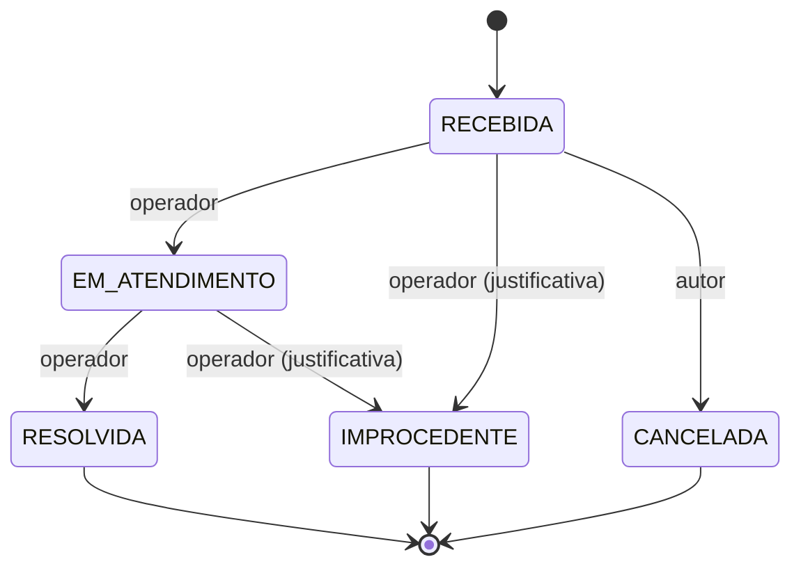

# Regras de negócio

Tudo o que for **[SUPOSIÇÃO]** está listado em [01 – seção 8](../01-visao-e-escopo.md#8-suposições-e-pendências).

## Resumo

| ID | Regra |
|---|---|
| RN-001 | Papéis e criação de contas |
| RN-002 | Tipos de denúncia |
| RN-003 | Status da denúncia e "em aberto" |
| RN-004 | Transições de status permitidas |
| RN-005 | Cancelamento pelo cidadão |
| RN-006 | Uma denúncia em aberto por cidadão |
| RN-007 | Status do bairro |
| RN-008 | Estabilidade da rede na Home |
| RN-009 | Previsão de reparo |
| RN-010 | Justificativa de improcedência |
| RN-011 | Histórico de status (auditoria) |
| RN-012 | Localização e bairro |
| RN-013 | Anexos |
| RN-014 | Visibilidade dos dados |
| RN-015 | Prioridade por necessidade especial |
| RN-016 | Agrupamento e resolução em lote |
| RN-017 | Indicadores dos últimos 30 dias |
| RN-018 | Duplicidade de denúncias |
| RN-019 | Notificações |
| RN-020 | Consentimento |
| RN-021 | Abrangência e bairros fixos |
| RN-022 | Validação do cadastro |
| RN-023 | Protocolo |
| RN-024 | Exclusão de conta |
| RN-025 | Bairro do usuário |

## Regras

### RN-001 – Papéis e criação de contas
Existem dois papéis: `CIDADAO` e `OPERADOR`. O cadastro público cria **somente** `CIDADAO`. Contas `OPERADOR` são criadas por *seed* (sem cadastro público). Cada rota da API declara os papéis que aceita (RBAC).

### RN-002 – Tipos de denúncia
Toda denúncia tem um tipo obrigatório: `SEM_ENERGIA` ("Sem energia") ou `OSCILACAO` ("Oscilação"). Os textos de exemplo da lista do protótipo ("queda brusca", "falta de fase", "curto-circuito" etc.) são **descrição livre**, não tipos.

### RN-003 – Status da denúncia e "em aberto"
Status possíveis: `RECEBIDA`, `EM_ATENDIMENTO`, `RESOLVIDA`, `IMPROCEDENTE` (definidos pela operadora) e `CANCELADA` (definido pelo cidadão). Uma denúncia está **em aberto** quando o status é `RECEBIDA` ou `EM_ATENDIMENTO`. Os demais são **finais**.

### RN-004 – Transições de status permitidas **[SUPOSIÇÃO: S-01]**

| De | Para | Quem |
|---|---|---|
| `RECEBIDA` | `EM_ATENDIMENTO` | Operador |
| `RECEBIDA` | `IMPROCEDENTE` | Operador (com justificativa, RN-010) |
| `RECEBIDA` | `CANCELADA` | Autor (RN-005) |
| `EM_ATENDIMENTO` | `RESOLVIDA` | Operador |
| `EM_ATENDIMENTO` | `IMPROCEDENTE` | Operador (com justificativa, RN-010) |

Estados finais não mudam. Qualquer outra transição é recusada (HTTP 422). Exceção única: resolução em lote (RN-016).

### RN-005 – Cancelamento pelo cidadão
Somente o **autor** pode cancelar, e somente enquanto a denúncia estiver `RECEBIDA`. Depois que a operadora iniciar o atendimento, o cidadão não cancela.

### RN-006 – Uma denúncia em aberto por cidadão
Um cidadão pode ter no máximo **1** denúncia em aberto (RN-003). A regra é validada no serviço e reforçada por índice único parcial no banco. Cancelar ou ter a denúncia finalizada libera um novo registro.

### RN-007 – Status do bairro
O status do bairro considera apenas denúncias **em aberto** (`RECEBIDA` ou `EM_ATENDIMENTO`), nesta ordem de precedência:

1. Há ao menos 1 denúncia `SEM_ENERGIA` → **Sem luz** (vermelho `#BA1A1A`).
2. Senão, há denúncias e todas são `OSCILACAO` → **Oscilação** (âmbar `#CE8300`).
3. Senão (nenhuma em aberto) → **Normal / Restabelecido** (verde `#34A853`).

O status é **calculado**, não armazenado.

**Chip "Restabelecidos" da lista pública (T-04) [SUPOSIÇÃO: S-21]:** ocorrências que passaram a `RESOLVIDA` nas **últimas 24 horas**. "Sem luz" e "Oscilação" listam as ocorrências em aberto do respectivo tipo; "Todos" é a soma dos três chips.

### RN-008 – Estabilidade da rede na Home **[SUPOSIÇÃO: S-02]**
"Rede Estável" quando o status do bairro do usuário é Normal; "Instável" quando é Sem luz ou Oscilação.

### RN-009 – Previsão de reparo **[SUPOSIÇÃO: S-03]**
É um campo **opcional**, informado pelo operador na denúncia, e deve ser uma data/hora futura no momento do cadastro. Na tela de ocorrências, a previsão do bairro é a **menor previsão futura** entre suas denúncias em aberto; se não houver, o campo não aparece.

### RN-010 – Justificativa de improcedência
Marcar como `IMPROCEDENTE` exige justificativa (texto de 10 a 500 caracteres), exibida ao autor no detalhe.

### RN-011 – Histórico de status (auditoria)
Toda mudança de status (inclusive a criação, com `statusAnterior` nulo) gera um registro com: denúncia, status anterior, status novo, quem alterou (usuário e papel), justificativa (se houver) e data/hora. O registro é imutável e gravado na mesma transação da mudança (RNF-010).

### RN-012 – Localização e bairro **[SUPOSIÇÃO: S-04]**
- O GPS preenche logradouro e coordenadas; o usuário pode editar.
- O **bairro é obrigatório**, vindo da lista fixa (RN-021).
- Com o GPS negado, o envio continua com logradouro e bairro digitados/escolhidos; coordenadas ficam vazias.
- Não há validação de raio nem de distância entre GPS e endereço.
- Denúncia sem coordenadas aparece na lista, mas não no mapa por pino (o círculo do bairro continua refletindo-a).

### RN-013 – Anexos
Opcional; até **3 fotos** por denúncia, **5 MB** cada, tipos JPEG e PNG **[SUPOSIÇÃO: S-09]**. Vídeo não é aceito no MVP.

### RN-014 – Visibilidade dos dados

| Dado | Autor | Outros cidadãos | Operador |
|---|:-:|:-:|:-:|
| Tipo, bairro, rua, descrição, status, horário | ✔ | ✔ | ✔ |
| Protocolo, histórico, previsão, justificativa | ✔ | ✘ (só previsão do bairro, RN-009) | ✔ |
| Fotos | ✔ | ✘ | ✔ |
| Nome e telefone do autor | ✔ | ✘ | ✔ |
| Coordenadas exatas | ✔ | ✘ (só pinos aproximados **[SUPOSIÇÃO]**) | ✔ |
| Pessoas no local, necessidade especial e detalhe | ✔ | ✘ | ✔ |

A lista pública usa uma projeção **anonimizada** (sem identificadores do autor). Os pinos públicos usam coordenadas arredondadas (3 casas decimais, ~110 m).

### RN-015 – Prioridade por necessidade especial
Denúncias com `necessidadeEspecial = true` são **prioritárias**: destaque visual no painel e ordenação no topo (antes das demais, e dentro do grupo da mais antiga para a mais recente). Quando marcado "Sim", o detalhe da situação é obrigatório.

### RN-016 – Agrupamento e resolução em lote **[SUPOSIÇÃO: S-01]**
O painel agrupa denúncias por bairro. O operador pode "Resolver todas do bairro": todas as denúncias **em aberto** daquele bairro passam a `RESOLVIDA`. É a única regra que permite `RECEBIDA → RESOLVIDA` direto. Cada denúncia gera seu próprio histórico (RN-011) e evento em tempo real. A ação exige confirmação.

### RN-017 – Indicadores dos últimos 30 dias
- **Usuários cadastrados:** total de cidadãos (acumulado).
- **Denúncias registradas:** criadas nos últimos 30 dias.
- **Em atendimento:** denúncias com status `EM_ATENDIMENTO` no momento.
- **Resolvidas:** denúncias que passaram a `RESOLVIDA` nos últimos 30 dias; a **taxa** é `resolvidas ÷ registradas` no período (limitada a 100%).

### RN-018 – Duplicidade de denúncias
Não há deduplicação automática. A mitigação é o limite de RN-006 e o **agrupamento por bairro** no painel (RN-016), onde o operador identifica vários relatos do mesmo problema. Confirmação de denúncias por vizinhos está **fora do MVP**.

### RN-019 – Notificações **[SUPOSIÇÃO: S-13]**
Toda mudança de status feita pelo **operador** gera evento em tempo real e, quando há token válido, push ao autor. O cancelamento feito pelo próprio autor não gera push. Push é prioridade Should; o WebSocket é Must. WhatsApp está fora do escopo.

### RN-020 – Consentimento
O cadastro exige aceite dos Termos de Uso e da Política de Privacidade, que informam o compartilhamento com a Equatorial Pará. Guardam-se `consentimentoEm` e `versaoTermos`. Sem aceite, não há conta. Base legal: consentimento (LGPD, art. 7º, I).

### RN-021 – Abrangência e bairros fixos
O app atende **somente Marabá-PA**. Bairros e folhas vêm de uma lista fixa (*seed*) com coordenadas do centro, e não são criados por usuários.

### RN-022 – Validação do cadastro **[SUPOSIÇÃO: S-12]**
Nome (2 a 100 caracteres), e-mail válido e único (sem diferenciar maiúsculas), senha com no mínimo 8 caracteres e igual à confirmação, telefone opcional no padrão brasileiro com DDD (ex.: `(94) 90000-0000`). **CPF e data de nascimento não são coletados.**

### RN-023 – Protocolo **[SUPOSIÇÃO: S-06]**
Cada denúncia recebe um protocolo único legível no formato `TL-AAAA-NNNNNN` (ano e sequência de 6 dígitos), gerado no servidor.

### RN-024 – Exclusão de conta **[SUPOSIÇÃO: S-11]**
Ao excluir a conta, nome, e-mail, telefone, senha e tokens de push são removidos; as denúncias são mantidas **anonimizadas** (sem vínculo com o autor) e as fotos são apagadas. Denúncias em aberto são canceladas automaticamente antes da exclusão.

### RN-025 – Bairro do usuário **[SUPOSIÇÃO: S-05]**
O bairro do usuário na Home é o de **centro mais próximo** das coordenadas do GPS (distância de Haversine), limitado a um raio máximo de 15 km; fora dele, o usuário escolhe o bairro manualmente. Sem GPS, usa-se o último bairro escolhido (guardado só no dispositivo).
