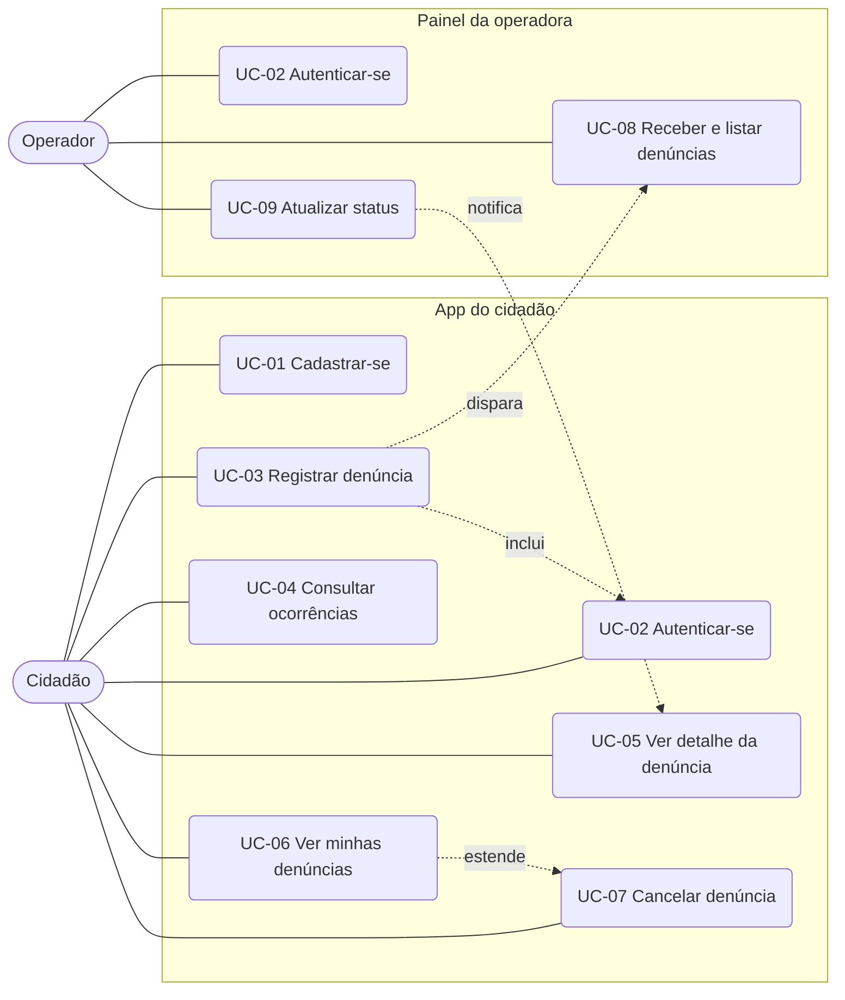

# 04 – Casos de uso

Cobre os casos principais: cadastro/login, registrar denúncia, listar ocorrências e mapa, detalhe, minhas denúncias, cancelar, listar denúncias no painel e atualizar status.

## Diagrama

Atores: **Cidadão** e **Operador**. A API e o serviço de push são sistemas de apoio.

| ID | Caso de uso | Ator | Requisitos |
|---|---|---|---|
| UC-01 | Cadastrar-se | Cidadão | RF-001, RF-002 |
| UC-02 | Autenticar-se | Cidadão, Operador | RF-003, RF-026 |
| UC-03 | Registrar denúncia | Cidadão | RF-007 a RF-012 |
| UC-04 | Consultar ocorrências (lista e mapa) | Cidadão | RF-016, RF-019 a RF-023 |
| UC-05 | Ver detalhe da denúncia | Cidadão | RF-014, RF-024 |
| UC-06 | Ver minhas denúncias | Cidadão | RF-013 |
| UC-07 | Cancelar denúncia | Cidadão | RF-015 |
| UC-08 | Receber e listar denúncias | Operador | RF-027 a RF-030, RF-034, RF-035 |
| UC-09 | Atualizar status da denúncia | Operador | RF-031 a RF-033, RF-036 |

---

## UC-01 – Cadastrar-se
- **Ator:** Cidadão. **Pré-condição:** não estar autenticado.
- **Pós-condição:** conta `CIDADAO` criada e sessão iniciada.
- **Regras:** RN-001, RN-020, RN-022.

**Fluxo principal**
1. O cidadão abre o app e escolhe "Cadastrar" (T-01).
2. Informa nome, e-mail, senha, confirmação de senha e, opcionalmente, telefone.
3. Lê e marca o aceite dos Termos de Uso e da Política de Privacidade.
4. Toca em "Cadastrar".
5. O sistema valida os dados, cria a conta, registra o consentimento e devolve o token.
6. O app abre a Home (T-03).

**Fluxos alternativos**
- A1. No passo 1, o cidadão já tem conta e toca em "Entrar": segue UC-02.
- A2. No passo 3, abre os Termos ou a Política para leitura e retorna ao formulário.

**Fluxos de exceção**
- E1. E-mail já cadastrado: mensagem de erro no campo, nada é criado.
- E2. Dados inválidos (senha curta, confirmação diferente, telefone inválido): mensagens nos campos.
- E3. Sem conexão: mensagem "Sem conexão", dados preservados no formulário.

## UC-02 – Autenticar-se
- **Atores:** Cidadão (app) e Operador (painel). **Pré-condição:** possuir conta.
- **Pós-condição:** sessão iniciada com token JWT.
- **Regras:** RN-001.

**Fluxo principal**
1. O usuário informa e-mail e senha no login (T-02 ou P-01).
2. O sistema valida as credenciais e devolve o token e o papel.
3. O app/painel guarda o token (SecureStore/armazenamento do navegador) e abre a tela inicial correspondente.

**Fluxos alternativos**
- A1. O cidadão toca em "Cadastrar": segue UC-01.

**Fluxos de exceção**
- E1. Credenciais inválidas: "E-mail ou senha incorretos".
- E2. Papel incompatível com a aplicação (cidadão no painel ou operador no app): acesso negado com instrução.
- E3. Excesso de tentativas (S-18): bloqueio temporário com mensagem.

## UC-03 – Registrar denúncia
- **Ator:** Cidadão. **Pré-condições:** autenticado; sem denúncia em aberto (RN-006).
- **Pós-condições:** denúncia `RECEBIDA` criada com protocolo; histórico inicial gravado; evento `denuncia:criada` enviado ao painel.
- **Regras:** RN-002, RN-006, RN-011, RN-012, RN-013, RN-015, RN-023.

**Fluxo principal**
1. O cidadão toca em "Denunciar" (botão central) ou no banner da Home (T-05).
2. O app pede permissão de localização, obtém o GPS, preenche logradouro, bairro e coordenadas e mostra o pino com "GPS Ativo".
3. O cidadão escolhe o tipo (**Sem energia** ou **Oscilação**).
4. Opcionalmente edita o endereço, informa ponto de referência e descrição.
5. Opcionalmente anexa até 3 fotos, informa pessoas no local e necessidade especial.
6. Toca em "Enviar denúncia".
7. O sistema valida, cria a denúncia, gera o protocolo, grava o histórico e emite os eventos em tempo real.
8. O app mostra a tela de sucesso (T-06) com o protocolo e as opções "Acompanhar denúncia" e "Voltar ao início".

**Fluxos alternativos**
- A1. GPS negado ou indisponível (passo 2): o cidadão digita o logradouro e escolhe o bairro; coordenadas ficam vazias.
- A2. O cidadão toca em "Acompanhar denúncia": segue UC-05.
- A3. O cidadão sai do formulário antes de enviar: o rascunho é guardado no dispositivo.

**Fluxos de exceção**
- E1. Já existe denúncia em aberto: o envio é recusado (409) e o app oferece "Ver minha denúncia em aberto" (UC-05).
- E2. Campo obrigatório ausente: mensagens nos campos, nada é enviado.
- E3. Foto acima de 5 MB ou 4º anexo: recusada com mensagem.
- E4. Sem conexão ou erro do servidor: mensagem clara; o rascunho é mantido e o cidadão pode tentar de novo.

## UC-04 – Consultar ocorrências (lista e mapa)
- **Ator:** Cidadão. **Pré-condição:** autenticado.
- **Regras:** RN-007, RN-008, RN-014, RN-025.

**Fluxo principal**
1. O cidadão abre a aba "Ocorrências" (T-04), ou toca em "Ver mapa ampliado" na Home.
2. O sistema carrega o status do bairro atual, os círculos dos bairros, os pinos das denúncias em aberto e a lista pública anonimizada.
3. O cidadão filtra por status pelos chips (Todos, Sem luz, Oscilação, Restabelecidos).
4. O cidadão toca em "expandir" para ver o mapa em tela cheia.
5. Mudanças chegam por WebSocket e atualizam mapa, lista e contadores.

**Fluxos alternativos**
- A1. O cidadão busca por bairro ou folha (RF-021).
- A2. Toca em "centralizar na minha localização".

**Fluxos de exceção**
- E1. Sem GPS: o mapa abre centralizado em Marabá e o bairro é escolhido manualmente.
- E2. Sem conexão: mostra o último cache com aviso e data da última atualização (RNF-007).
- E3. Nenhuma ocorrência: estado vazio "Nenhuma ocorrência no momento".

## UC-05 – Ver detalhe da denúncia
- **Ator:** Cidadão (autor). **Pré-condição:** denúncia própria existente.
- **Regras:** RN-009, RN-010, RN-011, RN-014.

**Fluxo principal**
1. O cidadão abre uma denúncia a partir de "Minhas denúncias", da tela de sucesso ou de um push (T-07).
2. O sistema mostra tipo, endereço, descrição, fotos, status atual, previsão de reparo, justificativa (se houver) e histórico.
3. Com a tela aberta, eventos `denuncia:status-atualizado` atualizam status e histórico sem recarregar.

**Fluxos alternativos**
- A1. Denúncia `RECEBIDA`: o botão "Cancelar denúncia" aparece (UC-07).

**Fluxos de exceção**
- E1. Denúncia de outro usuário ou inexistente: 404/403 com mensagem "Denúncia não encontrada".
- E2. Sem conexão: mostra a última versão em cache com aviso.

## UC-06 – Ver minhas denúncias
- **Ator:** Cidadão. **Pré-condição:** autenticado.

**Fluxo principal**
1. O cidadão abre Perfil e toca em "Minhas denúncias" (T-09).
2. O sistema lista suas denúncias, da mais recente para a mais antiga, com protocolo, tipo, bairro e status.
3. O cidadão toca em um item e segue UC-05.
4. Mudanças de status atualizam a lista em tempo real.

**Fluxos de exceção**
- E1. Lista vazia: "Você ainda não fez denúncias" com botão "Fazer denúncia".
- E2. Sem conexão: lista em cache com aviso.

## UC-07 – Cancelar denúncia
- **Ator:** Cidadão (autor). **Pré-condição:** denúncia própria com status `RECEBIDA`.
- **Pós-condição:** status `CANCELADA`, histórico gravado, painel notificado, limite do RN-006 liberado.
- **Regras:** RN-004, RN-005, RN-011.

**Fluxo principal**
1. No detalhe (T-07) ou na lista (T-09), o cidadão toca em "Cancelar denúncia".
2. O app pede confirmação.
3. O cidadão confirma.
4. O sistema altera o status para `CANCELADA`, grava o histórico e emite o evento ao painel.
5. O app mostra a denúncia como "Cancelada".

**Fluxos alternativos**
- A1. O cidadão toca em "Voltar" na confirmação: nada muda.

**Fluxos de exceção**
- E1. Operador já iniciou o atendimento (status mudou): o sistema recusa (422), o app atualiza o status e informa "Esta denúncia já está em atendimento".
- E2. Sem conexão: mensagem e nenhuma alteração.

## UC-08 – Receber e listar denúncias (painel)
- **Ator:** Operador. **Pré-condição:** autenticado com papel `OPERADOR`.
- **Regras:** RN-014, RN-015, RN-016.

**Fluxo principal**
1. O operador abre o painel (P-02); a lista carrega ordenada com prioritárias no topo.
2. O painel abre a conexão WebSocket e entra na sala de operadores.
3. Quando um cidadão envia uma denúncia, o painel recebe `denuncia:criada`, insere o item na lista e no mapa, destaca o item, mostra um alerta visual e toca o som (se ativado).
4. O operador filtra por status, tipo e bairro e alterna entre lista, mapa e visão agrupada por bairro.
5. O operador abre o detalhe de uma denúncia (P-03).

**Fluxos alternativos**
- A1. O operador usa "Resolver todas do bairro" na visão agrupada (RN-016, RF-034).
- A2. O operador ativa ou desativa o som do alerta.

**Fluxos de exceção**
- E1. Conexão em tempo real perdida: o painel mostra o aviso "Reconectando…", reconecta sozinho e refaz a consulta.
- E2. Token expirado: volta ao login.
- E3. Nenhuma denúncia para os filtros: estado vazio.

## UC-09 – Atualizar status da denúncia (painel)
- **Ator:** Operador. **Pré-condição:** denúncia em aberto.
- **Pós-condições:** novo status e histórico gravados na mesma transação; eventos emitidos; push enviado ao autor.
- **Regras:** RN-004, RN-009, RN-010, RN-011, RN-019.

**Fluxo principal**
1. O operador abre o detalhe da denúncia (P-03).
2. O painel mostra apenas as ações permitidas para o status atual (ex.: em `RECEBIDA`, "Iniciar atendimento" ou "Improcedente").
3. O operador escolhe "Iniciar atendimento" e, opcionalmente, informa a previsão de reparo.
4. O sistema valida a transição, grava o novo status e o histórico (RN-011) e emite `denuncia:status-atualizado` ao autor e aos operadores; envia push ao autor.
5. O painel atualiza o detalhe e a lista. O app do cidadão mostra o novo status em até 2 s.

**Fluxos alternativos**
- A1. Resolver: com a denúncia `EM_ATENDIMENTO`, o operador escolhe "Resolver".
- A2. Improcedente: o operador escolhe "Improcedente" e preenche a justificativa obrigatória (RN-010).
- A3. Apenas informar ou alterar a previsão de reparo, sem mudar o status.

**Fluxos de exceção**
- E1. Justificativa ausente em "Improcedente": 422 e mensagem no formulário.
- E2. Transição inválida ou conflito (o cidadão cancelou ou outro operador atualizou antes): o sistema recusa (422/409), o painel recarrega a denúncia e informa o novo estado.
- E3. Previsão no passado: recusada com mensagem.
- E4. Falha no envio do push: a mudança de status **não** é desfeita; o erro é registrado em log.
