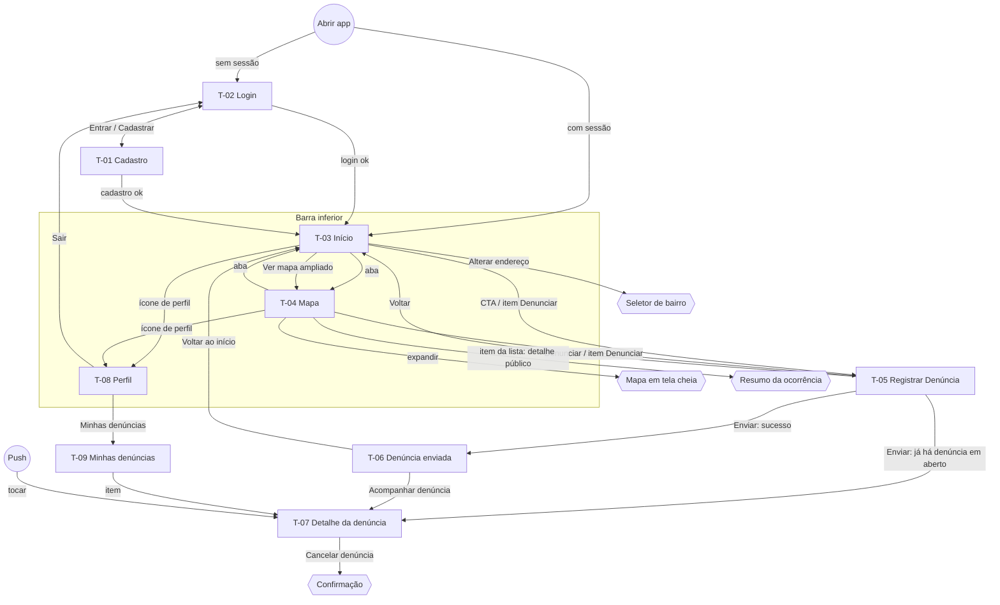
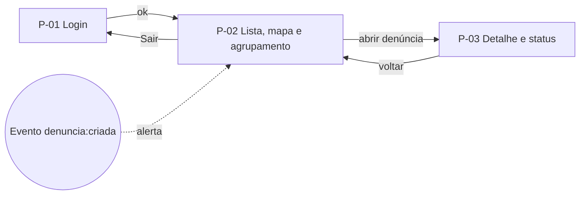

# 05 – Telas e fluxos

- **Arquivo Figma:** <https://www.figma.com/design/XiDKX3D8j02JggOwKPDdGp/Mobile---T%C3%A1-ligado-?node-id=0-1> (página única "Page principal").
- **Convenção:** `T-xx` = tela do app do cidadão; `P-xx` = tela do painel da operadora. Telas marcadas **(a criar)** não existem no Figma e estão descritas em [Telas a criar no protótipo](#telas-a-criar-no-protótipo).
- O protótipo tem 4 telas mobile (390 px) e 2 frames de apoio. Não há variáveis do Figma; os tokens vêm dos valores usados nas telas ([06](06-design-system.md)).

## Índice de telas

| ID | Tela | Situação | Node |
|---|---|---|---|
| T-01 | Acesso e Cadastro | Figma | [`2033:857`](https://www.figma.com/design/XiDKX3D8j02JggOwKPDdGp/Mobile---T%C3%A1-ligado-?node-id=2033-857) |
| T-02 | Login | a criar (mesmo layout de T-01) | — |
| T-03 | Início | Figma | [`2033:161`](https://www.figma.com/design/XiDKX3D8j02JggOwKPDdGp/Mobile---T%C3%A1-ligado-?node-id=2033-161) |
| T-04 | Ocorrências (Mapa e Bairros Afetados) | Figma | [`2033:403`](https://www.figma.com/design/XiDKX3D8j02JggOwKPDdGp/Mobile---T%C3%A1-ligado-?node-id=2033-403) |
| T-05 | Registrar Denúncia | Figma | [`2033:655`](https://www.figma.com/design/XiDKX3D8j02JggOwKPDdGp/Mobile---T%C3%A1-ligado-?node-id=2033-655) |
| T-06 | Denúncia enviada (sucesso) | a criar | — |
| T-07 | Detalhe da denúncia | a criar | — |
| T-08 | Perfil | a criar | — |
| T-09 | Minhas denúncias | a criar | — |
| T-10 | Ajuda (rota `/ajuda`) | a criar (design system v2) | — |
| C-01 | Barra inferior (componente) | Figma | [`2033:1080`](https://www.figma.com/design/XiDKX3D8j02JggOwKPDdGp/Mobile---T%C3%A1-ligado-?node-id=2033-1080) |
| C-02 | Identidade visual (logo e ícone) | Figma | [`2033:1136`](https://www.figma.com/design/XiDKX3D8j02JggOwKPDdGp/Mobile---T%C3%A1-ligado-?node-id=2033-1136) |
| P-01 | Painel: Login do operador | a criar | — |
| P-02 | Painel: Lista, mapa e agrupamento | a criar | — |
| P-03 | Painel: Detalhe e atualização de status | a criar | — |

## Diagrama de navegação

### App do cidadão

> O botão de detalhe da lista pública de T-04 abre apenas um **resumo anonimizado** (modal), e não T-07, que é exclusivo do autor (decisão S-24).

### Painel da operadora

---

## Telas do Figma

### T-01 – Acesso e Cadastro
[Figma `2033:857`](https://www.figma.com/design/XiDKX3D8j02JggOwKPDdGp/Mobile---T%C3%A1-ligado-?node-id=2033-857) · RF-001, RF-002 · RN-020, RN-022

**Objetivo:** criar conta de cidadão.

| Elemento | Detalhe |
|---|---|
| Barra superior (56 px) | Logo "Tá Ligado?" (lupa + texto + "MARABÁ • EM TEMPO REAL"); botões "Entrar" (secundário) e "Cadastrar" (primário) que alternam o modo |
| Ilustração | Ilustração de celular com cadeado em cartão verde |
| Título e subtítulo | "É rápido e fácil! Registre-se para começar a fazer suas denúncias." |
| Cartão do formulário (verde escuro) | Cabeçalho "Crie sua conta cidadã" com selo "Marabá • PA" |
| Campos | Nome completo, Seu melhor e-mail, Senha, Confirmar senha (com mostrar/ocultar), **Telefone (WhatsApp de contato → Telefone)** |
| Aceite | Checkbox "Eu concordo com os Termos de Uso e a Política de Privacidade" |
| Botões | "CADASTRAR →" (primário) |
| Rodapé do cartão | "Já tem uma conta? Faça login aqui" (alterna para T-02) e aviso de privacidade |
| Cards informativos | "Marabá Integrada" e "Status Imediato" |
| Rodapé | "© 2026 Equipe Tá Ligado?" e a iniciativa (a sigla "ACGM" do Figma foi substituída, PEN-01) |

- **Dados coletados:** nome, e-mail, senha, telefone (opcional), consentimento. **Vêm do usuário.**
- **Redesign v2 (R9) – T-01/T-02:** fundo `#F6F7F9`, barra com a marca e os botões **"Entrar"** e **"Cadastrar"** (48 dp; o ativo é azul cheio, o outro tem borda azul), título e **cartão branco** com o formulário (sem o cartão verde/azul-noite, sem o selo "Marabá • PA" e sem variante escura nos campos; decisão R-10). Botão primário **"Cadastrar"** / **"Entrar"** (caixa normal, ícone de seta; rótulo para leitor de tela "Cadastrar e criar conta" / "Entrar na conta", para não repetir o nome da barra), erro geral em `Aviso` (ícone + texto), links dos termos em azul sublinhado e a nota de privacidade em `Aviso` informativo.
- **Ações:** Cadastrar → T-03. Alternar → T-02. Termos/Política → texto.
- **Estados:** não desenhados. Previstos: validação por campo, carregando no botão, erro de e-mail duplicado, erro de rede.
- **Implementação (Passo 6):** o botão "CADASTRAR" é **branco com texto verde `#006E2C`** sobre o cartão verde-escuro (o verde do Figma sobre o verde do cartão não tem contraste); o botão fica desabilitado até aceitar os Termos; os links "Termos de Uso" e "Política de Privacidade" abrem telas próprias (`/termos`, `/privacidade`) com o texto de `docs/legal/`. Os cartões "Marabá Integrada" e "Status Imediato" e a ilustração do Figma ainda não foram implementados (decorativos). T-02 usa a mesma estrutura, com os textos "Entre na sua conta" e "ENTRAR".
- **Ajustes ao protótipo** (decisões do escopo): remover **CPF** e **Nascimento**; trocar "WhatsApp de contato" por "Telefone (opcional)"; remover "Cadastre com Google"; trocar "Seus dados de denúncia são criptografados e anônimos" por "Suas denúncias aparecem para outros cidadãos sem identificação"; ajustar o card "Status Imediato" (sem WhatsApp: "Receba avisos no celular quando o status da sua denúncia mudar"); checkbox na cor da marca (no Figma está azul `#0075FF`, padrão do navegador).

### T-03 – Início
[Figma `2033:161`](https://www.figma.com/design/XiDKX3D8j02JggOwKPDdGp/Mobile---T%C3%A1-ligado-?node-id=2033-161) (referência antiga) · RF-016, RF-017, RF-023, RF-024 · RN-007, RN-025

> **Design system v2 (S-44, etapa R4):** a tela foi refeita e **substitui o desenho do Figma**.

**Objetivo:** mostrar a energia no bairro do usuário agora e levar à ação principal ("Fazer denúncia").

De cima para baixo:

| Bloco | Detalhe |
|---|---|
| Cabeçalho | Logo e o botão de texto **"Ajuda"** (ícone + texto) → tela [T-10 Ajuda](#t-10--ajuda) |
| "Olá, {primeiro nome}" | `title1`, sem exclamação |
| **Cartão "Energia no seu bairro agora"** | Ícone grande da situação, o nome dela em `title2` na cor dela (**Sem energia / Oscilando / Normal**), a frase de apoio ("Nenhuma falta de energia avisada", "1 denúncia em aberto" ou "N denúncias em aberto"), a previsão de reparo (se houver, RN-009), uma divisória e o endereço com ícone de pino e o botão de texto **"Trocar"** |
| **Cartão da ação principal** (borda azul de 2) | "Ficou sem energia?", "Avise a Equatorial por aqui. Leva menos de 1 minuto." e o botão primário **"Fazer denúncia"** (ícone `flash-off`) → T-05 |
| Dois atalhos | **"Ver onde falta energia"** → Mapa (T-04) e **"Minhas denúncias"** → T-09 |
| "Como funciona" | 3 passos: "Você avisa que a energia caiu.", "A Equatorial recebe o aviso na hora.", "Você acompanha aqui até a energia voltar." |
| "Prefere falar com alguém?" | Horário da Central (placeholder, PEN-02) e o botão secundário **"Ligar para a Equatorial"** (`tel:`) |

**Origem do bairro (RN-025, RF-017):** o bairro mais próximo da localização do celular. **"Trocar"** abre a lista de bairros (com busca por bairro ou folha); a escolha vale para o cartão e fica salva **só no aparelho** (AsyncStorage, uma chave por usuário), **sem ir para o cadastro nem para a API**. Com a escolha feita, o cartão mostra o botão **"Usar minha localização"**, que volta ao GPS e apaga a escolha. Uma escolha que não existe mais na lista é ignorada.

**Estados:** buscando a localização; **GPS negado ou desligado** ("Não achamos você pela localização do celular", com "Escolher bairro" e "Tentar de novo"); **fora de Marabá** (com "Escolher bairro"); erro ao carregar (com "Tentar de novo"); sem conexão (dados salvos e aviso de conexão no topo). A situação muda em tempo real com o evento `bairro:status-atualizado`.

**Ficou de fora de propósito:** o mini-mapa (o mapa fica só na aba Mapa), o painel comunitário (Fase 2) e os selos "Rede Estável / Instável" (agora é Normal / Sem energia / Oscilando).

### T-04 – Mapa ("Onde falta energia")
[Figma `2033:403`](https://www.figma.com/design/XiDKX3D8j02JggOwKPDdGp/Mobile---T%C3%A1-ligado-?node-id=2033-403) (referência antiga) · RF-019 a RF-024 · RN-007, RN-009, RN-014

> **Design system v2 (S-44, etapas R3 e R5):** a aba "Ocorrências" passou a se chamar **"Mapa"** só no texto (a rota continua `/ocorrencias`). A tela foi refeita e **substitui o desenho do Figma**.

**Objetivo:** ver onde falta energia e consultar a lista pública, sem dados de ninguém.

| Bloco | Detalhe |
|---|---|
| Cabeçalho branco | Título **"Onde falta energia"**, o apoio **"Marabá · atualizado há X min"** (horário da própria resposta) e a busca com rótulo visível **"Procurar bairro ou folha"** (a API só procura bairro e folha) |
| Chips | **Todos (n), Sem energia (n), Oscilando (n), Normal (n)**, 48 dp, cada um com ícone; o selecionado é azul cheio com texto branco e os outros brancos com borda. "Normal" é o filtro `RESTABELECIDO` da API (resolvidas nas últimas 24 h, S-21); "Todos" é a soma dos três |
| Mapa | **Um marcador por ocorrência** com coordenadas (40 dp, ícone da situação, borda branca de 3 e contorno de 2 na cor da situação; **Sem energia e Oscilando redondos, Normal quadrado**); como **apoio**, uma **linha tracejada sem preenchimento** em volta de cada bairro afetado (o tracejado só no iOS; no Android a linha é contínua); ponto azul "você está aqui"; botão flutuante **"Onde estou"** (ícone e texto); legenda com os 3 marcadores e texto |
| **Lugares com aviso (n)** | **Um item por bairro**, agrupado no app a partir das ocorrências públicas (sem mudar a API): selo da situação (ícone + texto), "Bairro (Folha)" em negrito, **"Há X min · N avisos"** e "Ver" com seta. O cartão inteiro é clicável: **"Ver" centraliza o mapa no bairro** e leva a tela até ele |

**Regras do agrupamento (decisão R-03):** o lugar é o bairro + a folha; **a situação do lugar é a mais grave entre os avisos** (Sem energia > Oscilando > Normal, a mesma regra do status do bairro, RN-007), e um aviso resolvido conta como Normal; **"Há X min" conta a partir do aviso mais recente** do lugar; **N** é quantos avisos o lugar tem. Ordem: o mais grave primeiro e, empatando, o aviso mais recente primeiro. O centro do bairro (para o "Ver") vem de `/bairros/status`.

- **Dados:** servidor (`/ocorrencias` anonimizada, `/bairros/status`). **Nada pessoal:** sem protocolo, autor ou telefone (RN-014).
- **Estados:** carregando, vazio ("Nenhum lugar com aviso"), busca sem resultado, erro com "Tentar novamente", offline (dados salvos e aviso de conexão). Mostra os 50 avisos mais recentes e diz quando há mais.
- **Tempo real:** `ocorrencia:atualizada` busca a lista e os totais de novo; `bairro:status-atualizado` troca a cor da área do bairro na hora (e tira a área se o bairro voltar ao normal).
- **Saíram desta tela:** o cartão "Localização atual" (a energia do bairro agora fica na Início), o banner de denunciar e o bloco de atendimento (agora na Início e na Ajuda).

### T-05 – Registrar Denúncia
[Figma `2033:655`](https://www.figma.com/design/XiDKX3D8j02JggOwKPDdGp/Mobile---T%C3%A1-ligado-?node-id=2033-655) · RF-007 a RF-011 · RN-002, RN-006, RN-012, RN-013, RN-015

**Objetivo:** registrar a ocorrência.

| Elemento | Detalhe |
|---|---|
| Header | Botão voltar, título "Fazer Denúncia", botão de perfil |
| Introdução | Selo "Registro em Tempo Real", "Onde Faltou Luz?", subtítulo |
| Mini-mapa | Pino com rótulo do endereço, selo "GPS Ativo", legenda "Mapa interativo de acordo com endereço da denúncia" |
| Aviso de responsabilidade | Cartão recolhível com 3 orientações |
| Formulário (cartão verde) | "Descrição da Denúncia" (**remover "Passo 1 de 1"**) |
| **Tipo** (novo) | Seletor obrigatório: "Sem energia" / "Oscilação" |
| Endereço | Logradouro, Bairro, CEP (opcional, decisão S-25), Ponto de referência |
| Descrição | "Descreva o que aconteceu" (opcional, até 500 caracteres) |
| Registro visual | Cartão do anexo com miniatura, nome, tamanho, botões excluir e substituir; "Adicionar mais fotos" (até 3; vídeo removido) |
| Pessoas afetadas | Chips: 1 a 3, 4 a 8, 9 a 20, Rua Toda |
| Necessidade especial | "Sim, prioridade" / "Não há"; ao marcar Sim, aparece "Detalhe a situação prioritária" |
| Envio | "ENVIAR DENÚNCIA" e texto "Sua ocorrência será mapeada instantaneamente…" |

- **Dados:** do usuário (tipo, descrição, fotos, pessoas, necessidade especial); do GPS (coordenadas e endereço sugerido); do servidor (protocolo na resposta).
- **Ações:** Voltar → T-03. Enviar → T-06. Já há denúncia em aberto → mensagem e T-07.
- **Estados:** não desenhados. Previstos: enviando, erro por campo, erro de rede (rascunho preservado), GPS negado (escolha de bairro), limite de fotos.
- **Ajustes ao protótipo:** campo **Tipo**; texto "Registre apenas interrupções verídicas…" mantido; "Anexe imagens que comprovem…" → "Se puder, anexe fotos"; "Cadastros fiéis aceleram…" mantido; limite de 3 fotos; a mesma tela mostra "GPS desativado" quando sem permissão.

- **Implementação (Passo 7):** o formulário da Fase 1 tem **Tipo, Logradouro, Bairro (seletor com busca), CEP, Ponto de referência e Descrição**; fotos, pessoas afetadas e necessidade especial entram na Fase 2 (S-38). O mini-mapa tem pino arrastável e o selo "GPS ATIVO"; sem permissão aparece "GPS desativado" com o motivo e o envio continua sem coordenadas. O texto digitado fica salvo como rascunho (por usuário) até o servidor confirmar. Se já houver denúncia em aberto (409), a tela avisa e leva ao detalhe dela. **T-06** mostra o protocolo, permite copiá-lo e leva a T-07 ("Acompanhar denúncia") ou ao início.

- **Redesign v2 (R6) – T-05 em 3 passos, numa rota só (`/denunciar`):** (1) **"O que está acontecendo?"**: dois cartões de escolha ("Estou sem energia" e "A energia está oscilando"), aviso do 193 e "Continuar" (desativado, com o texto "Escolha uma opção para continuar", até escolher); (2) **"Onde está faltando energia?"**: mini-mapa com o local achado pelo celular, o endereço e a pergunta "Este endereço está certo?" com **"Sim, está certo"** ou **"Não, quero corrigir"** (abre Logradouro, Bairro e CEP já preenchidos; sem GPS os campos já vêm abertos e a denúncia segue sem coordenadas, RN-012); (3) **"Quer contar mais alguma coisa?"**: descrição e ponto de referência (opcionais), o resumo "O que será enviado", o aviso "Envie só avisos verdadeiros…" e **"Enviar denúncia"**. Fotos, pessoas afetadas e necessidade especial entram neste passo na Fase 2. O cabeçalho mostra "Passo X de 3" com barra de progresso; cada passo valida só os seus campos; o botão voltar do Android volta um passo; erro do servidor num campo leva ao passo dele; o 409 aparece no passo 3. Schema, rascunho, GPS, 409 e modo offline não mudaram. As orientações recolhíveis "Antes de enviar" foram trocadas por avisos curtos (passos 1 e 3). Ao enviar, vai para T-06 com id e protocolo.
- **Fase 2 (F2-2) – passo 3, pessoas e necessidade especial (RF-010, S-46, S-48):** "Quantas pessoas estão no local? (opcional)" com 4 chips de rádio (1 a 3, 4 a 8, 9 a 20, Rua toda; tocar de novo desmarca) e a pergunta "Alguém no local depende de aparelho elétrico, como respirador ou geladeira de remédios, ou tem necessidade especial?" com dois cartões de escolha (**Sim** / **Não**). Com "Sim" aparece, num cartão destacado, um aviso de que a informação é de saúde e a caixa de **consentimento específico**: "Autorizo enviar essa informação à Equatorial, só para dar prioridade ao atendimento. Ela é apagada quando a denúncia termina." Sem marcar, o "Sim" **não é enviado** e o resumo diz "Necessidade especial: não será enviada (falta a sua autorização)". O resumo "O que será enviado" mostra pessoas e necessidade. O rascunho guarda só pessoas (S-56). **T-07** ganhou o cartão "No local" (pessoas e, enquanto aberta, "Necessidade especial: informada (com prioridade)" ou "não").
- **Fase 2 (F2-3) – passo 3, fotos (RF-009, S-49):** "Fotos (opcional)" com o texto "Se puder, anexe fotos do problema. Elas ajudam a equipe, e só você e a Equatorial as veem.", o contador **"N de 3 fotos"**, os botões **"Tirar foto"** e **"Escolher da galeria"** (ícone e texto) e, para cada foto, a miniatura e o botão **"Remover foto N"** (com texto). A permissão da câmera é pedida **só ao tocar em "Tirar foto"**; se negada, aparece a explicação e a galeria continua disponível; se bloqueada de vez, "Abrir configurações". Com 3 fotos os botões ficam desativados, com o motivo escrito. **Toda** foto (câmera ou galeria, inclusive PNG ou HEIC) é convertida para **JPEG** e reduzida (lado maior de 1600 px, qualidade 0,7), o que descarta o EXIF original. O resumo mostra "Fotos: N anexada(s)". Com fotos o envio é `multipart`; sem fotos, JSON. As fotos **não vão para o rascunho** (S-56) e continuam anexadas se o envio falhar. **T-07** mostra as fotos num cartão "Fotos (N)" (cada uma pedida com o token, "Foto N de M").

- **Redesign v2 (R7) – T-06 "Denúncia enviada!":** círculo verde-claro com visto, título, o texto "A Equatorial já recebeu seu aviso. Vamos te avisar aqui quando a equipe estiver a caminho.", cartão com **"Número da denúncia"** (protocolo, selecionável), selo **"Recebida"**, o **local** e "Copiar protocolo", e os botões **"Acompanhar minha denúncia"** e **"Voltar ao início"** (fixos no rodapé). O local vem por parâmetros da rota (`logradouro` e `bairro`, passados pelo formulário); sem eles o cartão mostra só número e selo. Sem mudança na API.

- **Implementação (Passos 7 e 8) – T-07/T-09:** T-09 lista as denúncias do usuário (até 50) e atualiza em tempo real; T-07 mostra status, local, descrição, previsão (só em aberto), justificativa (improcedente) e o histórico em linha do tempo. **Ainda não há** mini-mapa no detalhe, fotos, pessoas afetadas/necessidade especial nem o botão "Cancelar denúncia" (Fase 2). O Perfil tem o item "Minhas denúncias" com o contador de abertas; editar dados e excluir conta ficam na Fase 2.

### C-01 – Barra inferior (componente)

> **Design system v2 (S-44, etapa R3):** substitui o desenho do Figma ([`2033:1080`](https://www.figma.com/design/XiDKX3D8j02JggOwKPDdGp/Mobile---T%C3%A1-ligado-?node-id=2033-1080)), que tinha o botão central flutuante só com ícone.

4 itens, **cada um com ícone e texto** (14, negrito): **Início**, **Mapa**, **Denunciar** e **Perfil**.

- **"Ocorrências" passou a se chamar "Mapa" só no texto.** A rota continua `/ocorrencias`, então a navegação e os links não mudam.
- **Sem botão flutuante.** "Denunciar" é um item normal: o ícone fica numa **pílula azul cheia (56 × 32)** e o texto, em azul. Ele abre o formulário (modal T-05); não é uma aba selecionável.
- **Aba ativa:** o ícone fica numa pílula `#DBE6FE` (56 × 32) e o texto em `#1E3A8A`. **Abas inativas:** `#475569`.
- **Fundo:** branco sólido com borda superior `#CBD5E1` e sem sombra. Alvos de toque de pelo menos 48 dp; a barra cresce com a fonte do sistema.
- Para o leitor de tela: cada aba é um botão com o nome e o estado "selecionado"; "Denunciar" tem a dica "Abre o formulário para avisar que faltou energia".

### C-02 – Identidade visual
[Figma `2033:1136`](https://www.figma.com/design/XiDKX3D8j02JggOwKPDdGp/Mobile---T%C3%A1-ligado-?node-id=2033-1136)

Logo horizontal (altura de 36 a 44 px), ícone quadrado (64 e 96 px) e destaque lima oficial **`#A3E635`** no "?". O frame ainda inclui o logo antigo "Cadê a luz, Marabá?" (descartado; o nome oficial é **Tá Ligado?**).

---

## Telas a criar no protótipo

Descrição proposta para que o protótipo seja completado seguindo o design system ([06](06-design-system.md)). São **sugestões** (S-17 para o painel).

### T-02 – Login
RF-003 · mesma estrutura de T-01 com o botão "Entrar" ativo.
- Barra superior com logo, "Entrar" (ativo) e "Cadastrar".
- Cartão verde "Entre na sua conta" com campos **E-mail** e **Senha** (mostrar/ocultar).
- Botão "ENTRAR →"; link "Não tem conta? Cadastre-se".
- Sem "Esqueci a senha" e sem Google (fora do MVP).
- Estados: carregando, "E-mail ou senha incorretos", sem conexão.
- **Redesign v2 (R9):** mesmo layout do cadastro (cartão branco, botão "Entrar" em caixa normal); ver T-01.

### T-06 – Denúncia enviada
RF-012
- Ícone de sucesso grande (check verde).
- Título "Denúncia enviada!", texto "Sua denúncia foi enviada à Equatorial Pará".
- Cartão com **protocolo** `TL-AAAA-NNNNNN` (botão copiar), tipo, bairro, horário e status "Recebida".
- Botões: "Acompanhar denúncia" (primário → T-07) e "Voltar ao início" (secundário → T-03).

### T-07 – Detalhe da denúncia
RF-014, RF-015, RF-024, RF-036 · UC-05
- Header com voltar e protocolo.
- Selo de status (cores de RN-007/RN-003) e tipo.
- Endereço/bairro e mini-mapa.
- Descrição e galeria de fotos (somente o autor vê).
- Pessoas no local e necessidade especial.
- "Previsão de reparo" (se informada).
- Justificativa (se `IMPROCEDENTE`).
- **Histórico de status**: linha do tempo com status, data/hora e quem mudou ("Equatorial Pará" ou "Você").
- Botão "Cancelar denúncia" (somente `RECEBIDA`), com confirmação.
- Estados: carregando, offline (cache), não encontrada.
- **Redesign v2 (R9):** cartões brancos; rótulos em caixa normal ("Local", "Descrição", "Previsão de reparo", "Histórico"); a **justificativa** (improcedente) aparece num `Aviso` de atenção com ícone; o histórico usa o **ícone do andamento** em cada passo (Recebida, Em atendimento, Resolvida, Improcedente, Cancelada).
- **Fase 2 (F2-1) – Cancelar denúncia (RF-015, S-55):** só em `RECEBIDA`, logo abaixo do cartão do status, o botão secundário **"Cancelar denúncia"** (ícone e texto). O toque abre uma confirmação na própria tela: "Cancelar esta denúncia? A operadora deixa de receber o seu aviso, e isso não pode ser desfeito.", com **"Sim, cancelar"** (primário) e **"Não, voltar"**. Depois de cancelar, o selo vira "Cancelada", o histórico ganha "Cancelada, por Você" e aparece o aviso "Denúncia cancelada. A operadora não vai mais atender este aviso.". Se a operadora já começou (422), a tela explica e busca o status real. A lista (T-09) não tem o botão.

### T-08 – Perfil
RF-004, RF-005, RF-006
- Avatar com iniciais, nome, e-mail, telefone, com "Editar" (nome e telefone).
- Item "Minhas denúncias" (com contador de abertas) → T-09.
- **Redesign v2 (R9):** dados da conta num cartão branco; o contador agora é **"{n} em aberto"** (caixa normal); "Sair" é botão secundário.
- Item "Termos de Uso e Política de Privacidade".
- Botão "Sair" e botão discreto "Excluir conta" (confirmação em duas etapas).
- Versão do app no rodapé.

### T-09 – Minhas denúncias
RF-013
- Header com voltar e título.
- Lista de cartões com protocolo, tipo, bairro, data e selo de status; atualiza em tempo real.
- Ação "Cancelar" nos itens `RECEBIDA`.
- Estado vazio "Você ainda não fez denúncias" com botão "Fazer denúncia"; carregando e erro.
- **Redesign v2 (R9):** cartão branco com número, selo do andamento (ícone + texto, caixa normal), tipo e bairro, data e **"Ver"** com seta; o cartão todo é um botão de 48 dp ou mais.

### T-10 – Ajuda
S-44 · design system v2 (etapa R4)

**Objetivo:** responder rápido a "como isso funciona?" e "e se eu precisar falar com alguém?". Rota `/ajuda`, aberta pelo botão **"Ajuda"** do cabeçalho da Início. Tela simples, só de leitura.

- **"Como funciona":** os mesmos 3 passos da Início.
- **Aviso de segurança:** "Fio caído ou risco de choque? Não chegue perto. Ligue para os Bombeiros: **193**." (o 193 é o número real).
- **Contatos:** horário da Central, Ouvidoria e Equatorial (valores de exemplo, PEN-02) e o botão **"Ligar para a Equatorial"**, que abre o discador. Se o aparelho não puder ligar, aparece uma mensagem clara com o número para anotar.
- **Sobre o aplicativo:** links com texto para **Termos de Uso** e **Política de Privacidade**.
- Cabeçalho com **"Voltar"** (ícone + texto).

### P-01 – Painel: Login do operador
RF-026
- Cartão centralizado com logo, "Painel da Operadora", campos E-mail e Senha, botão "Entrar".
- Mensagens de credencial inválida e de acesso negado (conta de cidadão).

### P-02 – Painel: Lista, mapa e agrupamento
RF-027 a RF-029, RF-034, RF-035
- **Barra superior:** logo, usuário logado, botão "Ativar som", indicador de conexão (Conectado/Reconectando), "Sair".
- **Indicadores:** contadores de Recebidas, Em atendimento, Resolvidas hoje.
- **Filtros:** status, tipo e bairro, com "Limpar".
- **Abas:** Lista | Mapa | Por bairro.
- **Lista:** tabela com prioridade (ícone), protocolo, tipo, bairro/rua, status, tempo desde o envio e ação "Abrir"; prioritárias no topo com destaque.
- **Mapa (Leaflet):** pinos por status/tipo; clique abre resumo.
- **Por bairro:** cartões com contagem de denúncias por tipo e status e botão "Resolver todas do bairro" (com confirmação).
- **Alerta de nova denúncia:** toast/banner "Nova denúncia: {tipo} em {bairro}", destaque temporário na linha e som.
- Estados: carregando, vazio, erro, desconectado.

- **Implementação (Passo 9):** barra superior com o nome do operador e "Sair" (som e indicador de conexão entram no Passo 10); filtros por status (padrão "Em aberto"), tipo, bairro e "Só prioritárias"; abas **Lista** e **Mapa** (a aba "Por bairro" e os indicadores ficam para a Fase 2). Pinos do mapa: vermelho = sem energia em aberto, âmbar = oscilação em aberto, cinza = encerrada; denúncias sem coordenadas aparecem só na lista.

- **Implementação (Passo 10):** a barra superior ganhou o indicador de conexão (Conectando… / Conectado / Reconectando…) e o botão "Ativar som" (o áudio só é criado depois do clique). Denúncia nova: faixa de alerta com "Abrir" e "Dispensar" (região `aria-live`), linha destacada por 10 s e, se o som estiver ativo, dois toques; ela entra na lista na ordem da RN-015 (no fim do seu grupo), não no topo.

### P-03 – Painel: Detalhe e atualização de status
RF-030 a RF-033, RF-036
- Cabeçalho com protocolo, status atual, selo "Prioritária" quando for o caso.
- Blocos: **Autor** (nome, telefone), **Local** (logradouro, bairro, ponto de referência, coordenadas, mini-mapa), **Ocorrência** (tipo, descrição, pessoas, necessidade especial e detalhe), **Fotos** (galeria).
- **Ações de status:** botões conforme o status atual (RN-004): "Iniciar atendimento", "Resolver", "Improcedente" (abre campo de justificativa obrigatório).
- **Previsão de reparo:** seletor de data/hora (opcional).
- **Histórico:** linha do tempo de mudanças com usuário, data/hora e justificativa.
- Estados: salvando, erro de transição inválida, conflito (recarregar).

- **Implementação (Passo 10):** blocos Autor, Local, Ocorrência, Atualizar status e Histórico. O mini-mapa, a galeria de fotos e o seletor de previsão fora do "Iniciar atendimento" ficam para a Fase 2. As ações vêm do status (cópia de `acoesDisponiveis` no painel; a API é quem decide); conflito (422) avisa e mostra a situação atual.
- **Fase 2 (F2-2):** no bloco Ocorrência, "Pessoas no local" e sempre a linha **Necessidade especial**: "Sim, prioridade (autorizado pelo cidadão em …)", "Não", "Não informada" ou "Informação apagada ao encerrar a denúncia" (RN-026). Sem texto livre. O alerta de nova denúncia diz "Nova denúncia prioritária: …" quando for o caso.
- **Fase 2 (F2-3):** cartão **"Fotos (N)"** com a galeria: cada foto é baixada com o token do operador (a rota é autenticada) e mostrada com o texto alternativo "Foto N de M enviada pelo cidadão"; uma foto que falha mostra "Não foi possível carregar a foto N" e "Tentar de novo" sem derrubar as outras; sem fotos, o cartão não aparece.
