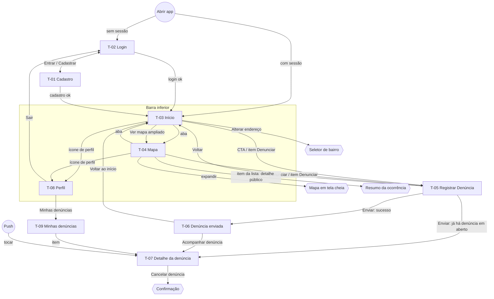
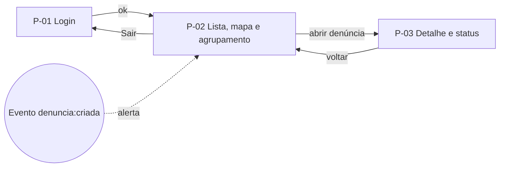

# 05 – Telas e fluxos

- **Arquivo Figma:** <https://www.figma.com/design/XiDKX3D8j02JggOwKPDdGp/Mobile---T%C3%A1-ligado-?node-id=0-1> (página única "Page principal").
- **Convenção:** `T-xx` = tela do app do cidadão; `P-xx` = tela do painel da operadora. Telas marcadas **(a criar)** não existem no Figma e estão descritas em [Telas a criar no protótipo](#telas-a-criar-no-protótipo).
- O protótipo tem 4 telas mobile (390 px) e 2 frames de apoio. Não há variáveis do Figma; os tokens vêm dos valores usados nas telas ([06](06-design-system.md)).

## Índice de telas

| ID | Tela | Situação | Node |
|---|---|---|---|
| T-01 | Acesso e Cadastro | Figma | [`2033:857`](https://www.figma.com/design/XiDKX3D8j02JggOwKPDdGp/Mobile---T%C3%A1-ligado-?node-id=2033-857) |
| T-02 | Login | a criar (mesmo layout de T-01) | — |
| T-03 | Início | Figma | [`2033:161`](https://www.figma.com/design/XiDKX3D8j02JggOwKPDdGp/Mobile---T%C3%A1-ligado-?node-id=2033-161) |
| T-04 | Ocorrências (Mapa e Bairros Afetados) | Figma | [`2033:403`](https://www.figma.com/design/XiDKX3D8j02JggOwKPDdGp/Mobile---T%C3%A1-ligado-?node-id=2033-403) |
| T-05 | Registrar Denúncia | Figma | [`2033:655`](https://www.figma.com/design/XiDKX3D8j02JggOwKPDdGp/Mobile---T%C3%A1-ligado-?node-id=2033-655) |
| T-06 | Denúncia enviada (sucesso) | a criar | — |
| T-07 | Detalhe da denúncia | a criar | — |
| T-08 | Perfil | a criar | — |
| T-09 | Minhas denúncias | a criar | — |
| C-01 | Barra inferior (componente) | Figma | [`2033:1080`](https://www.figma.com/design/XiDKX3D8j02JggOwKPDdGp/Mobile---T%C3%A1-ligado-?node-id=2033-1080) |
| C-02 | Identidade visual (logo e ícone) | Figma | [`2033:1136`](https://www.figma.com/design/XiDKX3D8j02JggOwKPDdGp/Mobile---T%C3%A1-ligado-?node-id=2033-1136) |
| P-01 | Painel: Login do operador | a criar | — |
| P-02 | Painel: Lista, mapa e agrupamento | a criar | — |
| P-03 | Painel: Detalhe e atualização de status | a criar | — |

## Diagrama de navegação

### App do cidadão

> O botão de detalhe da lista pública de T-04 abre apenas um **resumo anonimizado** (modal), e não T-07, que é exclusivo do autor (decisão S-24).

### Painel da operadora

---

## Telas do Figma

### T-01 – Acesso e Cadastro
[Figma `2033:857`](https://www.figma.com/design/XiDKX3D8j02JggOwKPDdGp/Mobile---T%C3%A1-ligado-?node-id=2033-857) · RF-001, RF-002 · RN-020, RN-022

**Objetivo:** criar conta de cidadão.

| Elemento | Detalhe |
|---|---|
| Barra superior (56 px) | Logo "Tá Ligado?" (lupa + texto + "MARABÁ • EM TEMPO REAL"); botões "Entrar" (secundário) e "Cadastrar" (primário) que alternam o modo |
| Ilustração | Ilustração de celular com cadeado em cartão verde |
| Título e subtítulo | "É rápido e fácil! Registre-se para começar a fazer suas denúncias." |
| Cartão do formulário (verde escuro) | Cabeçalho "Crie sua conta cidadã" com selo "Marabá • PA" |
| Campos | Nome completo, Seu melhor e-mail, Senha, Confirmar senha (com mostrar/ocultar), **Telefone (WhatsApp de contato → Telefone)** |
| Aceite | Checkbox "Eu concordo com os Termos de Uso e a Política de Privacidade" |
| Botões | "CADASTRAR →" (primário) |
| Rodapé do cartão | "Já tem uma conta? Faça login aqui" (alterna para T-02) e aviso de privacidade |
| Cards informativos | "Marabá Integrada" e "Status Imediato" |
| Rodapé | "© 2026 Equipe Tá Ligado?" e a iniciativa (a sigla "ACGM" do Figma foi substituída, PEN-01) |

- **Dados coletados:** nome, e-mail, senha, telefone (opcional), consentimento. **Vêm do usuário.**
- **Ações:** Cadastrar → T-03. Alternar → T-02. Termos/Política → texto.
- **Estados:** não desenhados. Previstos: validação por campo, carregando no botão, erro de e-mail duplicado, erro de rede.
- **Implementação (Passo 6):** o botão "CADASTRAR" é **branco com texto verde `#006E2C`** sobre o cartão verde-escuro (o verde do Figma sobre o verde do cartão não tem contraste); o botão fica desabilitado até aceitar os Termos; os links "Termos de Uso" e "Política de Privacidade" abrem telas próprias (`/termos`, `/privacidade`) com o texto de `docs/legal/`. Os cartões "Marabá Integrada" e "Status Imediato" e a ilustração do Figma ainda não foram implementados (decorativos). T-02 usa a mesma estrutura, com os textos "Entre na sua conta" e "ENTRAR".
- **Ajustes ao protótipo** (decisões do escopo): remover **CPF** e **Nascimento**; trocar "WhatsApp de contato" por "Telefone (opcional)"; remover "Cadastre com Google"; trocar "Seus dados de denúncia são criptografados e anônimos" por "Suas denúncias aparecem para outros cidadãos sem identificação"; ajustar o card "Status Imediato" (sem WhatsApp: "Receba avisos no celular quando o status da sua denúncia mudar"); checkbox na cor da marca (no Figma está azul `#0075FF`, padrão do navegador).

### T-03 – Início
[Figma `2033:161`](https://www.figma.com/design/XiDKX3D8j02JggOwKPDdGp/Mobile---T%C3%A1-ligado-?node-id=2033-161) · RF-016, RF-017, RF-018, RF-023, RF-024 · RN-007, RN-008, RN-017, RN-025

**Objetivo:** visão geral da situação do bairro e porta de entrada para denunciar.

| Elemento | Detalhe |
|---|---|
| Header (64 px) | Logo e botão circular de perfil (vai a T-08) |
| Cartão de status | "Olá, {nome}!", selo "Rede Estável" ou "Instável", endereço aproximado, botão "alterar endereço" |
| Banner herói | Selo "Central de Monitoramento Cidadão", "Faltou energia? Denuncie agora e ajude a resolver mais rápido!", botão "Registre sua denúncia" |
| Mapa | Seção "Descubra onde pode estar sem energia" com mapa, tag da via, zonas vermelha/amarela com rótulo e legenda ("Apagão confirmado", "Oscilação de rede"); link "Ver mapa ampliado" |
| Painel Comunitário | "Últimos 30 dias": usuários cadastrados, casos restabelecidos (taxa), denúncias registradas, casos em atendimento |
| Como funciona | 3 passos: "Notifique a queda em 2 cliques", "Mapeamos a área afetada", "Cobramos a concessionária" |
| Atendimento | Horário da Central e telefone da Ouvidoria (placeholders, PEN-02) |
| Barra inferior | Início, Mapa, Denunciar, Perfil (todos com texto; sem FAB, ver [C-01](#c-01--barra-inferior-componente)) |

- **Dados:** nome (cadastro); posição/bairro (GPS → servidor, RN-025); status do bairro, contagens, indicadores e zonas (servidor).
- **Ações:** "Registre sua denúncia" e FAB → T-05. "Ver mapa ampliado" → T-04. Perfil → T-08. "Alterar endereço" → seletor de bairro (RF-017).
- **Estados:** não desenhados. Previstos: carregando (esqueleto), sem GPS (escolher bairro), offline (cache + aviso), erro.
- **Ajustes ao protótipo:** remover os selos "+12%" e "Em rota"; rótulo "Casos restabelecidos" calculado por RN-017; aba "Mapa" → "Ocorrências"; "Cobramos a concessionária" permanece (o protocolo vai ao painel simulado).

### T-04 – Ocorrências (Mapa e Bairros Afetados)
[Figma `2033:403`](https://www.figma.com/design/XiDKX3D8j02JggOwKPDdGp/Mobile---T%C3%A1-ligado-?node-id=2033-403) · RF-019 a RF-024 · RN-007, RN-009, RN-014

**Objetivo:** ver onde há falta de energia e consultar a lista pública.

| Elemento | Detalhe |
|---|---|
| Cartão "Localização atual" | Bairro/endereço, selo "Instável", contagem de denúncias em aberto no bairro, "Previsão de reparo técnico: ~ 1h 20min" |
| Busca | "Buscar bairro ou folha (ex.: Folha 28)" (CEP retirado, S-15) |
| Chips | Todos (n), Sem Luz (n), Oscilação (n), Restabelecidos (n) |
| Mapa | Zonas por bairro, rótulos, legenda em pílula ("Sem energia", "Oscilação"), botões "centralizar" e "expandir" |
| Banner de ação | "Deu falta de energia? Avise seus vizinhos e a concessionária" com botão "Denunciar" |
| Lista dos lugares | Cabeçalho "LISTA DOS LUGARES • Atualizado agora"; itens com borda colorida por status, bairro, descrição, data e "Há X min" e botão de detalhe |
| Rodapé | Telefone da concessionária/ouvidoria (PEN-02) |

- **Dados:** servidor (ocorrências públicas anonimizadas, status por bairro, previsão); GPS (centralizar).
- **Ações:** chips filtram; busca; "expandir" abre o mapa em tela cheia; "Denunciar" → T-05; botão de item → resumo anonimizado.
- **Estados:** não desenhados. Previstos: vazio ("Nenhuma ocorrência no momento"), carregando, erro, offline.
- **Ajustes ao protótipo:** "3 denúncias no raio de 500 m hoje" → "N denúncias em aberto no seu bairro" (S-04); rótulo "Atualizado agora" vira o horário real do último evento; rótulo de aba "Ocorrências".

- **Implementação (Passo 12):** T-03 mostra "Olá, {nome}!", o selo Rede Estável/Instável (RN-008), o mini-mapa e o atendimento; **não** tem painel comunitário, "alterar endereço" nem indicadores (Fase 2). T-04: busca por bairro/folha, chips com contagem, mapa com círculo por bairro e pinos, lista pública anonimizada (50 mais recentes) e banner. O botão de detalhe de cada item (resumo anonimizado, S-24) não foi feito; a lista é só de leitura. O botão de perfil do cabeçalho da Home se chama "Meu perfil" para não repetir o nome da aba "Perfil".

### T-05 – Registrar Denúncia
[Figma `2033:655`](https://www.figma.com/design/XiDKX3D8j02JggOwKPDdGp/Mobile---T%C3%A1-ligado-?node-id=2033-655) · RF-007 a RF-011 · RN-002, RN-006, RN-012, RN-013, RN-015

**Objetivo:** registrar a ocorrência.

| Elemento | Detalhe |
|---|---|
| Header | Botão voltar, título "Fazer Denúncia", botão de perfil |
| Introdução | Selo "Registro em Tempo Real", "Onde Faltou Luz?", subtítulo |
| Mini-mapa | Pino com rótulo do endereço, selo "GPS Ativo", legenda "Mapa interativo de acordo com endereço da denúncia" |
| Aviso de responsabilidade | Cartão recolhível com 3 orientações |
| Formulário (cartão verde) | "Descrição da Denúncia" (**remover "Passo 1 de 1"**) |
| **Tipo** (novo) | Seletor obrigatório: "Sem energia" / "Oscilação" |
| Endereço | Logradouro, Bairro, CEP (opcional, decisão S-25), Ponto de referência |
| Descrição | "Descreva o que aconteceu" (opcional, até 500 caracteres) |
| Registro visual | Cartão do anexo com miniatura, nome, tamanho, botões excluir e substituir; "Adicionar mais fotos" (até 3; vídeo removido) |
| Pessoas afetadas | Chips: 1 a 3, 4 a 8, 9 a 20, Rua Toda |
| Necessidade especial | "Sim, prioridade" / "Não há"; ao marcar Sim, aparece "Detalhe a situação prioritária" |
| Envio | "ENVIAR DENÚNCIA" e texto "Sua ocorrência será mapeada instantaneamente…" |

- **Dados:** do usuário (tipo, descrição, fotos, pessoas, necessidade especial); do GPS (coordenadas e endereço sugerido); do servidor (protocolo na resposta).
- **Ações:** Voltar → T-03. Enviar → T-06. Já há denúncia em aberto → mensagem e T-07.
- **Estados:** não desenhados. Previstos: enviando, erro por campo, erro de rede (rascunho preservado), GPS negado (escolha de bairro), limite de fotos.
- **Ajustes ao protótipo:** campo **Tipo**; texto "Registre apenas interrupções verídicas…" mantido; "Anexe imagens que comprovem…" → "Se puder, anexe fotos"; "Cadastros fiéis aceleram…" mantido; limite de 3 fotos; a mesma tela mostra "GPS desativado" quando sem permissão.

- **Implementação (Passo 7):** o formulário da Fase 1 tem **Tipo, Logradouro, Bairro (seletor com busca), CEP, Ponto de referência e Descrição**; fotos, pessoas afetadas e necessidade especial entram na Fase 2 (S-38). O mini-mapa tem pino arrastável e o selo "GPS ATIVO"; sem permissão aparece "GPS desativado" com o motivo e o envio continua sem coordenadas. O texto digitado fica salvo como rascunho (por usuário) até o servidor confirmar. Se já houver denúncia em aberto (409), a tela avisa e leva ao detalhe dela. **T-06** mostra o protocolo, permite copiá-lo e leva a T-07 ("Acompanhar denúncia") ou ao início.

- **Implementação (Passos 7 e 8) – T-07/T-09:** T-09 lista as denúncias do usuário (até 50) e atualiza em tempo real; T-07 mostra status, local, descrição, previsão (só em aberto), justificativa (improcedente) e o histórico em linha do tempo. **Ainda não há** mini-mapa no detalhe, fotos, pessoas afetadas/necessidade especial nem o botão "Cancelar denúncia" (Fase 2). O Perfil tem o item "Minhas denúncias" com o contador de abertas; editar dados e excluir conta ficam na Fase 2.

### C-01 – Barra inferior (componente)

> **Design system v2 (S-44, etapa R3):** substitui o desenho do Figma ([`2033:1080`](https://www.figma.com/design/XiDKX3D8j02JggOwKPDdGp/Mobile---T%C3%A1-ligado-?node-id=2033-1080)), que tinha o botão central flutuante só com ícone.

4 itens, **cada um com ícone e texto** (14, negrito): **Início**, **Mapa**, **Denunciar** e **Perfil**.

- **"Ocorrências" passou a se chamar "Mapa" só no texto.** A rota continua `/ocorrencias`, então a navegação e os links não mudam.
- **Sem botão flutuante.** "Denunciar" é um item normal: o ícone fica numa **pílula azul cheia (56 × 32)** e o texto, em azul. Ele abre o formulário (modal T-05); não é uma aba selecionável.
- **Aba ativa:** o ícone fica numa pílula `#DBE6FE` (56 × 32) e o texto em `#1E3A8A`. **Abas inativas:** `#475569`.
- **Fundo:** branco sólido com borda superior `#CBD5E1` e sem sombra. Alvos de toque de pelo menos 48 dp; a barra cresce com a fonte do sistema.
- Para o leitor de tela: cada aba é um botão com o nome e o estado "selecionado"; "Denunciar" tem a dica "Abre o formulário para avisar que faltou energia".

### C-02 – Identidade visual
[Figma `2033:1136`](https://www.figma.com/design/XiDKX3D8j02JggOwKPDdGp/Mobile---T%C3%A1-ligado-?node-id=2033-1136)

Logo horizontal (altura de 36 a 44 px), ícone quadrado (64 e 96 px) e destaque lima oficial **`#A3E635`** no "?". O frame ainda inclui o logo antigo "Cadê a luz, Marabá?" (descartado; o nome oficial é **Tá Ligado?**).

---

## Telas a criar no protótipo

Descrição proposta para que o protótipo seja completado seguindo o design system ([06](06-design-system.md)). São **sugestões** (S-17 para o painel).

### T-02 – Login
RF-003 · mesma estrutura de T-01 com o botão "Entrar" ativo.
- Barra superior com logo, "Entrar" (ativo) e "Cadastrar".
- Cartão verde "Entre na sua conta" com campos **E-mail** e **Senha** (mostrar/ocultar).
- Botão "ENTRAR →"; link "Não tem conta? Cadastre-se".
- Sem "Esqueci a senha" e sem Google (fora do MVP).
- Estados: carregando, "E-mail ou senha incorretos", sem conexão.

### T-06 – Denúncia enviada
RF-012
- Ícone de sucesso grande (check verde).
- Título "Denúncia enviada!", texto "Sua denúncia foi enviada à Equatorial Pará".
- Cartão com **protocolo** `TL-AAAA-NNNNNN` (botão copiar), tipo, bairro, horário e status "Recebida".
- Botões: "Acompanhar denúncia" (primário → T-07) e "Voltar ao início" (secundário → T-03).

### T-07 – Detalhe da denúncia
RF-014, RF-015, RF-024, RF-036 · UC-05
- Header com voltar e protocolo.
- Selo de status (cores de RN-007/RN-003) e tipo.
- Endereço/bairro e mini-mapa.
- Descrição e galeria de fotos (somente o autor vê).
- Pessoas no local e necessidade especial.
- "Previsão de reparo" (se informada).
- Justificativa (se `IMPROCEDENTE`).
- **Histórico de status**: linha do tempo com status, data/hora e quem mudou ("Equatorial Pará" ou "Você").
- Botão "Cancelar denúncia" (somente `RECEBIDA`), com confirmação.
- Estados: carregando, offline (cache), não encontrada.

### T-08 – Perfil
RF-004, RF-005, RF-006
- Avatar com iniciais, nome, e-mail, telefone, com "Editar" (nome e telefone).
- Item "Minhas denúncias" (com contador de abertas) → T-09.
- Item "Termos de Uso e Política de Privacidade".
- Botão "Sair" e botão discreto "Excluir conta" (confirmação em duas etapas).
- Versão do app no rodapé.

### T-09 – Minhas denúncias
RF-013
- Header com voltar e título.
- Lista de cartões com protocolo, tipo, bairro, data e selo de status; atualiza em tempo real.
- Ação "Cancelar" nos itens `RECEBIDA`.
- Estado vazio "Você ainda não fez denúncias" com botão "Fazer denúncia"; carregando e erro.

### P-01 – Painel: Login do operador
RF-026
- Cartão centralizado com logo, "Painel da Operadora", campos E-mail e Senha, botão "Entrar".
- Mensagens de credencial inválida e de acesso negado (conta de cidadão).

### P-02 – Painel: Lista, mapa e agrupamento
RF-027 a RF-029, RF-034, RF-035
- **Barra superior:** logo, usuário logado, botão "Ativar som", indicador de conexão (Conectado/Reconectando), "Sair".
- **Indicadores:** contadores de Recebidas, Em atendimento, Resolvidas hoje.
- **Filtros:** status, tipo e bairro, com "Limpar".
- **Abas:** Lista | Mapa | Por bairro.
- **Lista:** tabela com prioridade (ícone), protocolo, tipo, bairro/rua, status, tempo desde o envio e ação "Abrir"; prioritárias no topo com destaque.
- **Mapa (Leaflet):** pinos por status/tipo; clique abre resumo.
- **Por bairro:** cartões com contagem de denúncias por tipo e status e botão "Resolver todas do bairro" (com confirmação).
- **Alerta de nova denúncia:** toast/banner "Nova denúncia: {tipo} em {bairro}", destaque temporário na linha e som.
- Estados: carregando, vazio, erro, desconectado.

- **Implementação (Passo 9):** barra superior com o nome do operador e "Sair" (som e indicador de conexão entram no Passo 10); filtros por status (padrão "Em aberto"), tipo, bairro e "Só prioritárias"; abas **Lista** e **Mapa** (a aba "Por bairro" e os indicadores ficam para a Fase 2). Pinos do mapa: vermelho = sem energia em aberto, âmbar = oscilação em aberto, cinza = encerrada; denúncias sem coordenadas aparecem só na lista.

- **Implementação (Passo 10):** a barra superior ganhou o indicador de conexão (Conectando… / Conectado / Reconectando…) e o botão "Ativar som" (o áudio só é criado depois do clique). Denúncia nova: faixa de alerta com "Abrir" e "Dispensar" (região `aria-live`), linha destacada por 10 s e, se o som estiver ativo, dois toques; ela entra na lista na ordem da RN-015 (no fim do seu grupo), não no topo.

### P-03 – Painel: Detalhe e atualização de status
RF-030 a RF-033, RF-036
- Cabeçalho com protocolo, status atual, selo "Prioritária" quando for o caso.
- Blocos: **Autor** (nome, telefone), **Local** (logradouro, bairro, ponto de referência, coordenadas, mini-mapa), **Ocorrência** (tipo, descrição, pessoas, necessidade especial e detalhe), **Fotos** (galeria).
- **Ações de status:** botões conforme o status atual (RN-004): "Iniciar atendimento", "Resolver", "Improcedente" (abre campo de justificativa obrigatório).
- **Previsão de reparo:** seletor de data/hora (opcional).
- **Histórico:** linha do tempo de mudanças com usuário, data/hora e justificativa.
- Estados: salvando, erro de transição inválida, conflito (recarregar).

- **Implementação (Passo 10):** blocos Autor, Local, Ocorrência, Atualizar status e Histórico. O mini-mapa, a galeria de fotos e o seletor de previsão fora do "Iniciar atendimento" ficam para a Fase 2. As ações vêm do status (cópia de `acoesDisponiveis` no painel; a API é quem decide); conflito (422) avisa e mostra a situação atual.
