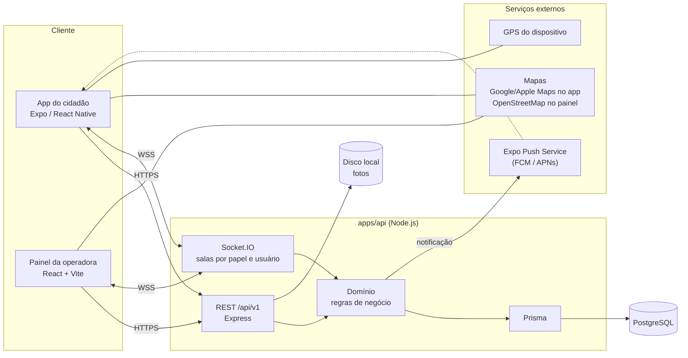
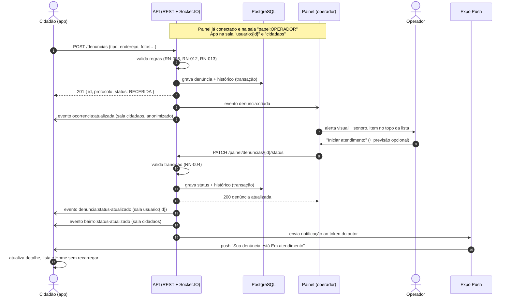

# 07 – Arquitetura

Decisões registradas em ADRs: [0001 integração simulada](adr/0001-integracao-simulada-com-operadora.md), [0002 Socket.IO](adr/0002-socketio-para-tempo-real.md), [0003 monorepo](adr/0003-monorepo-com-tres-aplicacoes.md), [0004 JWT + RBAC](adr/0004-autenticacao-jwt-com-rbac.md), [0005 offline simples](adr/0005-estrategia-offline-simples.md).

## 1. Visão geral

Um **monorepo** com três aplicações e um banco:

- `apps/mobile`: app do **cidadão** (React Native + Expo).
- `apps/painel`: **Painel Web da Operadora** (React + Vite), que simula a Equatorial Pará.
- `apps/api`: backend único (Node.js + Express + Prisma) com REST e Socket.IO.
- **PostgreSQL** (Docker Compose) e disco local para fotos.



### Integração com a operadora: simulada hoje, real no futuro

No MVP, o **Painel Web** faz o papel da Equatorial Pará: recebe as denúncias em tempo real e devolve os status. **Num cenário real, o painel seria substituído por uma integração via API com o sistema da Equatorial** (envio das denúncias por API/fila, recebimento de status por *webhook* ou consulta periódica, mapeamento de protocolos). Essa é uma **evolução futura** (backlog, [14](14-roadmap-e-backlog.md)). Para facilitar a troca, a API isola a regra em um módulo `operadora` (porta/adaptador): hoje o adaptador é o próprio painel; amanhã, um cliente HTTP da Equatorial. Ver [ADR-0001](adr/0001-integracao-simulada-com-operadora.md).

## 2. Fluxo em tempo real



Contratos dos eventos em [10 – API](10-api.md#eventos-websocket).

## 3. Camadas e organização do backend (`apps/api`)

```
apps/api/
├── prisma/
│   ├── schema.prisma
│   ├── migrations/
│   └── seed.ts              # bairros de Marabá e operadores
├── src/
│   ├── app.ts               # Express (middlewares, rotas)
│   ├── server.ts            # HTTP + Socket.IO
│   ├── config/              # env, constantes
│   ├── modules/
│   │   ├── auth/            # register, login, JWT, RBAC
│   │   ├── usuarios/        # perfil, exclusão de conta, push-token
│   │   ├── bairros/         # lista, bairro mais próximo, status
│   │   ├── denuncias/       # criar, minhas, detalhe, cancelar, fotos
│   │   ├── ocorrencias/     # lista pública anonimizada, indicadores
│   │   └── painel/          # lista/filtros, status, lote
│   ├── domain/              # regras puras, testáveis (sem I/O)
│   │   ├── status-bairro.ts      # RN-007
│   │   ├── transicoes.ts         # RN-004, RN-005, RN-016
│   │   ├── limite-denuncia.ts    # RN-006
│   │   ├── permissoes.ts         # RN-001, RN-014
│   │   └── protocolo.ts          # RN-023
│   ├── realtime/            # Socket.IO: salas, emissão de eventos
│   ├── notifications/       # envio de push (expo-server-sdk)
│   ├── operadora/           # porta/adaptador da integração (ADR-0001)
│   └── shared/              # erros, validação, logger
└── tests/
```

Cada módulo segue `routes → controller → service → repository (Prisma)`. As regras de negócio vivem em `domain/` (funções puras) e são chamadas pelos *services* (RNF-020). Eventos em tempo real são emitidos **depois** do commit da transação.

## 4. App do cidadão (`apps/mobile`)

### Organização de pastas (Expo Router)

```
apps/mobile/
├── app/                          # rotas (Expo Router)
│   ├── _layout.tsx               # providers (Query, Auth, Socket)
│   ├── (auth)/
│   │   ├── login.tsx             # T-02
│   │   └── cadastro.tsx          # T-01
│   ├── (app)/
│   │   ├── (tabs)/
│   │   │   ├── _layout.tsx       # barra inferior com FAB "Denunciar"
│   │   │   ├── index.tsx         # T-03 Início
│   │   │   ├── ocorrencias.tsx   # T-04
│   │   │   └── perfil.tsx        # T-08
│   │   ├── denunciar.tsx         # T-05 (modal)
│   │   ├── denuncia/
│   │   │   ├── sucesso.tsx       # T-06
│   │   │   └── [id].tsx          # T-07
│   │   └── minhas-denuncias.tsx  # T-09
├── src/
│   ├── components/               # design system (AppHeader, Button, Chip…)
│   ├── features/                 # auth, denuncia, ocorrencias, perfil
│   │   └── <feature>/ { api.ts, hooks.ts, schemas.ts, components/ }
│   ├── services/                 # http (axios/fetch), socket, push, location
│   ├── store/                    # sessão (Zustand)
│   ├── theme/                    # tokens (06)
│   ├── config/constants.ts       # telefones e textos placeholder (PEN-02)
│   └── utils/
├── assets/                       # fontes, logo, ilustrações
└── __tests__/
```

> **Ajuste da Fase 0:** no Expo SDK 58 as rotas ficam em **`src/app/`** (e não em `app/` na raiz do app), junto de `src/components`, `src/theme` e `src/config`. A aba central é um marcador `src/app/(app)/(tabs)/fab.tsx` (o botão `ReportFab` abre o modal `src/app/(app)/denunciar.tsx`), porque uma rota `denunciar` dentro e fora do grupo `(tabs)` teria a mesma URL.
>
> **Estrutura real após o Passo 6 (S-41):**
> ```
> src/app/
> ├── _layout.tsx            # providers + Stack.Protected (sessão)
> ├── (auth)/ { login, cadastro }          # só existe SEM sessão
> ├── (app)/                               # só existe COM sessão
> │   ├── (tabs)/ { index, ocorrencias, perfil, fab }
> │   └── denunciar.tsx                    # modal (T-05)
> └── termos.tsx · privacidade.tsx         # abertos com ou sem sessão
> src/ { components, config, features/auth, legal, services, store, testing, theme, __tests__ }
> ```
> - **Sem sessão**, o app abre o login; **com sessão**, as abas. A regra está no layout raiz: `Stack.Protected guard={!logado} redirectTo="/"` para `(auth)` e `guard={logado} redirectTo="/login"` para `(app)`. **O `redirectTo="/login"` é obrigatório:** sem ele, um app aberto sem sessão mostra "Unmatched Route", porque a rota `/` só existe dentro de `(app)`.
> - A sessão (token e usuário) fica no `expo-secure-store`; o layout raiz mantém a tela de abertura até a sessão ser lida (evita o login "piscar" para quem já entrou).
> - Um 401 `NAO_AUTENTICADO` com token derruba a sessão e limpa o cache (`encerrarSessao`); a guarda leva ao login sozinha.
> - Arquivos de teste ficam **fora** de `src/app/` (o Expo Router os trataria como rotas): em `src/__tests__/` (telas e navegação) e ao lado do código (lógica); auxiliares em `src/testing/`.

### Gerenciamento de estado

| Tipo de estado | Ferramenta | Exemplos |
|---|---|---|
| Servidor (remoto, com cache) | **TanStack Query** | ocorrências, minhas denúncias, detalhe, indicadores |
| Sessão e preferências | **Zustand** + `expo-secure-store` | token, usuário, último bairro |
| Formulários | **React Hook Form** + **Zod** | cadastro, login, denúncia |
| Tempo real | **socket.io-client** em um *provider* | cada evento invalida ou atualiza o cache do TanStack Query |
| Local efêmero | `useState` | filtros, seção recolhida |

Eventos WebSocket **não** criam um segundo "banco" no cliente: apenas atualizam o cache do TanStack Query (`setQueryData` / `invalidateQueries`), mantendo uma única fonte de verdade.

### Estratégia offline ([ADR-0005](adr/0005-estrategia-offline-simples.md))

O app é *offline-tolerante*, não *offline-first*:

1. **Leitura:** o cache do TanStack Query é persistido em `AsyncStorage` (`persistQueryClient`). Sem rede, abre Home, Ocorrências e Minhas denúncias com o último estado e um `OfflineBanner` com a data da última atualização (RNF-007). A rede é monitorada com `@react-native-community/netinfo`.
2. **Escrita:** o envio de denúncia exige conexão. O formulário é salvo como **rascunho** local a cada alteração e limpo apenas após `201` (RNF-008). Sem rede, o botão mostra o erro e preserva os dados.
3. **Sem fila automática:** evita duplicidade e conflito com a regra de uma denúncia em aberto (RN-006). Fila de envio offline fica no backlog.
4. **Tempo real:** ao reconectar o WebSocket (ou voltar ao primeiro plano), o app **refaz as consultas ativas** para recuperar o que perdeu (RNF-009).

## 5. Painel da operadora (`apps/painel`)

```
apps/painel/
├── src/
│   ├── main.tsx · App.tsx · routes.tsx      # React Router
│   ├── pages/ { Login, Painel, Detalhe }    # P-01, P-02, P-03
│   ├── components/ { Filtros, Tabela, Mapa, Agrupado, Linha do tempo, Toast }
│   ├── services/ { http.ts, socket.ts, som.ts }
│   ├── store/ (Zustand: sessão) · hooks/ (TanStack Query)
│   └── styles/tokens.css
└── tests/
```

- Mapa com **Leaflet** (tiles OpenStreetMap), pinos por status e tipo.
- Alerta sonoro via `HTMLAudioElement`, habilitado por um clique inicial (S-19).
- Estado servidor com TanStack Query; novos eventos `denuncia:criada` e `denuncia:status-atualizado` atualizam o cache e destacam a linha.

## 6. Serviços externos

| Serviço | Uso | Observações |
|---|---|---|
| **GPS** (`expo-location`) | Coordenadas e endereço sugerido (geocodificação reversa), bairro mais próximo | Permissão "ao usar o app"; precisão balanceada |
| **Mapas no app** (`react-native-maps`) | Mapa de Marabá, círculos, pinos, mini-mapa | Google Maps (Android) e Apple Maps (iOS). Builds Android exigem chave (PEN-04). Alternativa descartada: Mapbox (conta e tarifação) |
| **Mapas no painel** (Leaflet + OpenStreetMap) | Pinos das denúncias | Sem chave de API; uso leve, adequado a demonstração |
| **Notificações push** (Expo Push Service) | Aviso de mudança de status | Requer *development build* e credenciais FCM/APNs (PEN-04). Envio pelo servidor com `expo-server-sdk` |
| **Armazenamento de fotos** | Disco local (`uploads/`) | Servidas por rota autenticada. Em produção: S3 ou equivalente (trabalho futuro) |

## 7. Segurança e implantação (resumo)

- Autenticação JWT e RBAC ([ADR-0004](adr/0004-autenticacao-jwt-com-rbac.md)); no Socket.IO, o token é validado no *handshake* e o cliente entra apenas nas salas permitidas ao seu papel.
- Salas: `papel:OPERADOR`, `cidadaos` (eventos públicos anonimizados) e `usuario:{id}` (eventos privados do autor).
- Desenvolvimento: `docker compose up -d` (PostgreSQL) + `npm run dev` em cada app. Demonstração: API e painel numa VPS ou serviço gratuito, com HTTPS (RNF-013).
- Variáveis em `.env` (`DATABASE_URL`, `JWT_SECRET`, `EXPO_PUSH_ACCESS_TOKEN` opcional, `API_URL` etc.), com `.env.example` versionado (RNF-023).

## 8. Trabalho futuro de arquitetura

- Substituir o painel por **integração via API com a Equatorial** (ADR-0001).
- Fila de envio offline com idempotência por `clientId`.
- Armazenamento de fotos em nuvem e CDN; escala horizontal do Socket.IO (adaptador Redis).
- Polígonos geográficos de bairros (PostGIS) em vez de centros.
