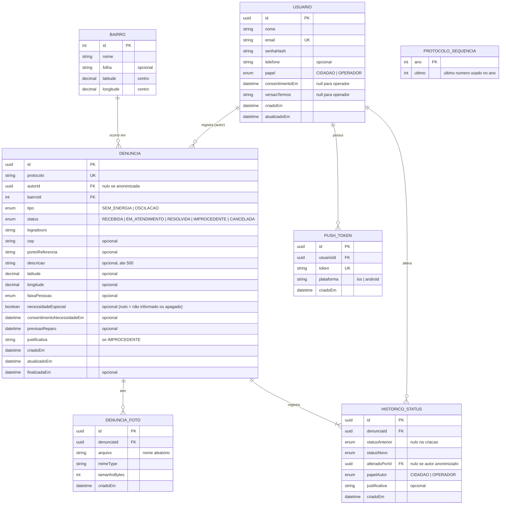

# 09 – Modelo de dados

Banco **PostgreSQL**, esquema gerenciado por **Prisma** (`apps/api/prisma/schema.prisma`). Nomes de tabela e campo em português, sem acentos, para alinhar com o domínio. Regras citadas estão em [regras-de-negocio.md](02-requisitos/regras-de-negocio.md).

## Diagrama ER

## Entidades e atributos

### `Usuario`
| Campo | Tipo | Regras |
|---|---|---|
| `id` | UUID | PK |
| `nome` | texto | 2 a 100 caracteres (RN-022) |
| `email` | texto | único, em minúsculas (RN-022) |
| `senhaHash` | texto | bcrypt (RNF-011) |
| `telefone` | texto? | padrão brasileiro; opcional (RN-022) |
| `papel` | enum | `CIDADAO` ou `OPERADOR` (RN-001) |
| `consentimentoEm`, `versaoTermos` | data?, texto? | obrigatórios para cidadão (RN-020) |
| `criadoEm`, `atualizadoEm` | data | — |

**Não existem** campos de CPF nem data de nascimento (minimização). Operadores são criados por seed.

### `Bairro`
| Campo | Tipo | Regras |
|---|---|---|
| `id` | inteiro | PK |
| `nome` | texto | ex.: "Nova Marabá", "Cidade Nova", "Velha Marabá" |
| `folha` | texto? | ex.: "Folha 28" (para a Nova Marabá) |
| `latitude`, `longitude` | decimal | centro do bairro/folha (RN-025) |

Único por (`nome`, `folha`). Lista fixa via seed (RN-021, PEN-07). O **status do bairro não é armazenado** (RN-007).

### `Denuncia`
| Campo | Tipo | Regras |
|---|---|---|
| `id` | UUID | PK |
| `protocolo` | texto | único, `TL-AAAA-NNNNNN` (RN-023); sequência por ano |
| `autorId` | UUID? | FK para `Usuario`; `SET NULL` ao excluir a conta (RN-024) |
| `bairroId` | inteiro | FK para `Bairro`, obrigatório (RN-012) |
| `tipo` | enum | `SEM_ENERGIA` / `OSCILACAO` (RN-002) |
| `status` | enum | RN-003; padrão `RECEBIDA` |
| `logradouro` | texto | obrigatório |
| `cep` | texto? | opcional (decisão S-25) |
| `pontoReferencia`, `descricao` | texto? | descrição até 500 (S-07) |
| `latitude`, `longitude` | decimal? | vazias sem GPS (RN-012) |
| `faixaPessoas` | enum? | `ATE_3`, `DE_4_A_8`, `DE_9_A_20`, `RUA_TODA` |
| `necessidadeEspecial` | booleano? | Só Sim/Não (S-46); `null` = não informado, ou apagado ao encerrar a denúncia (RN-026). `true` = prioritária (RN-015). CHECK: `true` exige `consentimentoNecessidadeEm`; status final exige os dois nulos |
| `consentimentoNecessidadeEm` | data? | Consentimento específico do "Sim" (LGPD, art. 11, I); apagado junto com a resposta. A coluna `detalheNecessidade` (texto livre) **foi removida na F2-2** |
| `previsaoReparo` | data? | informada pelo operador (RN-009) |
| `justificativa` | texto? | obrigatória em `IMPROCEDENTE` (RN-010) |
| `criadoEm`, `atualizadoEm`, `finalizadaEm` | data | `finalizadaEm` em estados finais |

**Restrições e índices**
- Índice único parcial (SQL na migration): no máximo uma denúncia em aberto por autor (RN-006).
  `CREATE UNIQUE INDEX denuncia_autor_aberta_uk ON "Denuncia" ("autorId") WHERE status IN ('RECEBIDA','EM_ATENDIMENTO') AND "autorId" IS NOT NULL;`
- Índices em (`status`, `bairroId`), (`bairroId`, `status`, `tipo`) e `criadoEm`, para filtros do painel e cálculo do status do bairro.
- `CHECK`: se `status = 'IMPROCEDENTE'` então `justificativa` não é nula.

### `DenunciaFoto`
| Campo | Tipo | Regras |
|---|---|---|
| `id` | UUID | PK |
| `denunciaId` | UUID | FK, `CASCADE` |
| `arquivo` | texto | nome aleatório em disco (RNF-015) |
| `mimeType`, `tamanhoBytes` | texto, inteiro | JPEG/PNG, ≤ 5 MB (RN-013) |

Máximo de 3 por denúncia (validado no serviço).

### `HistoricoStatus`
| Campo | Tipo | Regras |
|---|---|---|
| `id` | UUID | PK |
| `denunciaId` | UUID | FK, `CASCADE` |
| `statusAnterior` | enum? | nulo na criação |
| `statusNovo` | enum | — (num registro `PREVISAO`, é igual ao `statusAnterior`) |
| `evento` | enum | `STATUS` (mudança de status, padrão) ou `PREVISAO` (só a previsão de reparo mudou, S-60). A migration da F2-5 deu `STATUS` a todos os registros que já existiam |
| `previsaoReparo` | data? | previsão definida neste registro; **nula num evento `PREVISAO` = previsão removida** |
| `alteradoPorId` | UUID? | FK para `Usuario`, `SET NULL` |
| `papelAutor` | enum | papel de quem alterou (auditoria, RN-011) |
| `justificativa` | texto? | — |
| `criadoEm` | data | imutável (sem `UPDATE`) |

### `PushToken`
| Campo | Tipo | Regras |
|---|---|---|
| `id` | UUID | PK |
| `usuarioId` | UUID | FK, `CASCADE` |
| `token` | texto | único (token Expo) |
| `plataforma` | texto | `ios` ou `android` |

Removido no logout (RF-004) e na exclusão de conta.

### `ProtocoloSequencia`
| Campo | Tipo | Regras |
|---|---|---|
| `ano` | inteiro | PK |
| `ultimo` | inteiro | Último número de protocolo usado no ano |

Incrementada de forma **atômica** (`INSERT … ON CONFLICT (ano) DO UPDATE SET ultimo = ultimo + 1 RETURNING ultimo`) dentro da transação que cria a denúncia (RN-023, S-34). Se a criação falhar, a transação desfaz o incremento e a sequência não fica com buracos. Não tem relacionamento com as outras tabelas.

## Visões derivadas (não armazenadas)

| Visão | Como é calculada |
|---|---|
| Status do bairro | `SEM_ENERGIA` em aberto ⇒ Sem luz; só `OSCILACAO` em aberto ⇒ Oscilação; nenhuma ⇒ Normal (RN-007) |
| Ocorrência pública | Projeção de `Denuncia` sem `autorId`, fotos, protocolo, pessoas e necessidade; coordenadas arredondadas (RN-014) |
| Indicadores 30 dias | Agregações sobre `Usuario` e `Denuncia` (RN-017) |
| Previsão do bairro | Menor `previsaoReparo` futura entre as denúncias em aberto do bairro (RN-009) |

## Seed inicial

- Bairros de exemplo: Nova Marabá (Folhas 20, 21, 28, 32), Cidade Nova, Velha Marabá (Orla), Laranjeiras, Liberdade, Bairro da Paz (nomes vistos no protótipo; coordenadas aproximadas, **a validar**, PEN-07).
- Operadores: 2 contas de demonstração com senha definida por variável de ambiente (nunca no repositório).
