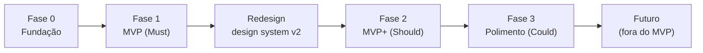

# 14 – Roadmap e backlog

Priorização por **MoSCoW** e por dependência técnica. O prazo informado é de **uma semana**, contada a partir de **2026-11-18** (entrega por volta de 2026-11-25). As fases foram distribuídas em **dias** na seção [Cronograma](#cronograma-de-uma-semana); as datas são **referência**, e a equipe avança por prioridade, sem se prender a elas. Esforço: **P** (≤ 1 dia), **M** (2 a 3 dias), **G** (≥ 4 dias), estimativa inicial.

## Roadmap

| Fase | Objetivo | Entrega observável |
|---|---|---|
| **0 – Fundação** | Monorepo, ambiente, CI, banco, tema | `docker compose up` + apps abrindo, CI verde |
| **1 – MVP (Must)** | Ciclo completo cidadão → operadora → cidadão | Demonstração: cadastra, denuncia, painel recebe em tempo real, operador atualiza, app reflete |
| **Redesign do app (v2)** | Novo design system (azul para tocar, situação da energia sempre com ícone e texto, Atkinson Hyperlegible) e telas novas, só em `apps/mobile` | App no novo visual, com o mesmo comportamento da Fase 1 ([17](17-plano-redesign.md)) |
| **2 – MVP+ (Should)** | Completar experiência e conformidade | Fotos, perfil/exclusão de conta, painel comunitário, previsão, lote, prioridade e, **por último, o push** |
| **3 – Polimento (Could)** | Refinos | Busca, mapa em tela cheia, alterar endereço, E2E |
| **Futuro** | Evolução | Itens da seção "Fora do MVP" |

> **Nova ordem (decisão de 2026-11-23):** a Fase 1 está concluída e mergeada na `develop`. O prazo foi estendido: agora vem o **redesign completo do app** (etapas R0 a R10, em [17 – Plano do redesign](17-plano-redesign.md)) e **só depois a Fase 2**, que já será construída com os componentes novos. O cronograma de uma semana abaixo é o plano original e **fica como referência histórica**; as datas dos dias 5 a 7 não valem mais.

## Cronograma de uma semana

Os últimos dias ficam reservados a **testes, ajustes e preparação da apresentação**. A ordem de desenvolvimento segue a decisão D-03: tudo o que é **Must** roda no **Expo Go** (tempo real por WebSocket); o **push** (Should) e o *development build* ficam **por último**.

| Dia | Data (ref.) | Foco | Itens do backlog |
|---|---|---|---|
| 1 | 18/11 (qua) | **Fase 0:** monorepo, banco, esqueletos, tema, lint e CI | B-001 a B-006 |
| 2 | 19/11 (qui) | **Fase 1, backend:** domínio com testes, auth, denúncias, Socket.IO | B-010, B-011, B-013, B-014, B-017, B-019 |
| 3 | 20/11 (sex) | **Fase 1, app e painel (base):** cadastro/login, Registrar Denúncia, sucesso; login do painel e lista | B-012, B-015, B-016, B-020 |
| 4 | 21/11 (sáb) | **Fase 1, fechamento do Must:** Home, Ocorrências, detalhe, alerta em tempo real e atualização de status no painel | B-018, B-021, B-022, B-023 |
| 5 | 22/11 (dom) | **Fase 2 (Should, sem push):** fotos, pessoas/necessidade especial, prioridade, previsão, lote, cancelar, perfil e exclusão de conta, indicadores, acessibilidade | B-031 a B-039 |
| 6 | 23/11 (seg) | **Testes e ajustes:** integração da API, correções; *Could* (B-040 a B-042) só se sobrar tempo; **push por último** (B-030, com *development build*) se houver tempo | B-024, B-030, B-040 a B-044 |
| 7 | 24/11 (ter) | **Congelar o escopo:** testes finais, correções, README com roteiro de demonstração, ensaio e preparação da apresentação | B-025 |
| — | 25/11 (qua) | Entrega / apresentação | — |

> **Risco declarado:** a soma das estimativas das Fases 1 e 2 é maior que sete dias de uma única pessoa. Com **três integrantes** em paralelo (API, app, painel) é viável, mas, se o prazo apertar, corta-se nesta ordem: B-044, B-043, B-040 a B-042, B-030 (push), B-035 (lote), B-038 (indicadores). O **Must** não é cortado.

> O **plano detalhado da Fase 1** (PRs, arquivos, testes e critérios) está em [16 – Plano de implementação da Fase 1](16-plano-fase-1.md).

## Backlog priorizado

### Fase 0 – Fundação

| ID | Item | Esforço | Requisitos |
|---|---|---|---|
| B-001 | Criar monorepo (npm workspaces), ESLint, Prettier, `.editorconfig`, commitlint | P | RNF-019, [ADR-0003](adr/0003-monorepo-com-tres-aplicacoes.md) |
| B-002 | `docker-compose.yml` com PostgreSQL; `.env.example` | P | RNF-022, RNF-023 |
| B-003 | API base (Express, config, erros, logger) + Prisma + migrations iniciais + seed (bairros e operadores) | M | RNF-021, RN-021 |
| B-004 | App Expo + Expo Router + tema/tokens + fontes + componentes base | M | [06](06-design-system.md) |
| B-005 | Painel Vite + React Router + tokens | P | [06](06-design-system.md) |
| B-006 | Workflow de CI (lint, tipos e testes) | P | RNF-019 |

### Fase 1 – MVP (Must)

| ID | Item | Esforço | Requisitos / regras |
|---|---|---|---|
| B-010 | Domínio: status do bairro, transições, limite, permissões, protocolo + **testes unitários** | M | RN-004 a RN-007, RN-023, RF-023, RF-011 |
| B-011 | Auth: cadastro, login, JWT, RBAC, middleware | M | RF-001, RF-003, RF-026, RN-001, RN-020, RN-022 |
| B-012 | Telas T-01 e T-02 (cadastro/login) com consentimento e termos | M | RF-001, RF-002, RF-003 |
| B-013 | API de denúncias: criar, minhas, detalhe, histórico (transação) | G | RF-007, RF-011, RF-013, RF-014, RF-036, RN-006, RN-011, RN-012 |
| B-014 | Socket.IO: autenticação, salas e eventos | M | RF-024, RF-027, [ADR-0002](adr/0002-socketio-para-tempo-real.md) |
| B-015 | App: tela Registrar Denúncia com GPS, tipo, bairro, validações e rascunho | G | RF-007, RF-008, RNF-008 |
| B-016 | App: sucesso (T-06), Minhas denúncias (T-09), Detalhe (T-07) com tempo real | G | RF-012, RF-013, RF-014, RF-024 |
| B-017 | API de bairros/ocorrências: status por bairro, lista pública anonimizada, bairro mais próximo | M | RF-016, RF-019, RF-020, RN-014, RN-025 |
| B-018 | App: Home (T-03) e Ocorrências (T-04) com mapa, chips e lista | G | RF-016, RF-019, RF-020, RF-023 |
| B-019 | API painel: listagem com filtros, detalhe, atualizar status | M | RF-028, RF-030, RF-031, RF-032 |
| B-020 | Painel: login (P-01), lista e filtros, mapa (P-02) | G | RF-026, RF-028, RF-029 |
| B-021 | Painel: alerta visual e sonoro em tempo real | M | RF-027, S-19 |
| B-022 | Painel: detalhe e atualização de status com justificativa (P-03) | M | RF-030, RF-031, RF-032 |
| B-023 | Estados vazio/erro/carregando/offline e cache persistido | M | RNF-006, RNF-007, RNF-009 |
| B-024 | Testes de integração da API (fluxos principais) | M | [13](13-estrategia-de-testes.md) |
| B-025 | README com roteiro de demonstração e instruções de execução | P | — |

### Fase 2 – MVP+ (Should)

| ID | Item | Esforço | Requisitos |
|---|---|---|---|
| B-030 | **Push (último item a ser feito):** registro de token, envio com `expo-server-sdk`, abrir detalhe pelo toque; exige *development build* (D-03) | G | RF-025, RN-019 |
| B-031 | Anexar até 3 fotos (upload, rota autenticada, miniaturas) | M | RF-009, RN-013, RNF-015 |
| B-032 | Pessoas afetadas e necessidade especial (consentimento específico) | P | RF-010, RN-015 |
| B-033 | Prioridade no painel (destaque e ordenação) | P | RF-035 |
| B-034 | Previsão de reparo (painel, detalhe e card do bairro) | M | RF-033, RN-009 |
| B-035 | Agrupamento por bairro e resolução em lote | M | RF-034, RN-016 |
| B-036 | Cancelar denúncia recebida | P | RF-015, RN-005 |
| B-037 | Perfil: ver/editar dados; **excluir conta** (anonimização) | M | RF-004, RF-005, RF-006, RN-024 |
| B-038 | Painel comunitário (indicadores de 30 dias) | P | RF-018, RN-017 |
| B-039 | Acessibilidade: rótulos, contraste, alvos de toque, fontes a 200% | M | RNF-024, [12](12-acessibilidade.md) |

### Redesign do app (design system v2): antes da Fase 2

| ID | Item | Esforço | Referência |
|---|---|---|---|
| B-046 | Redesign completo do app do cidadão (tokens e fonte, componentes, barra inferior, Início, Mapa, Denunciar em 3 passos, Sucesso, Ajuda, ajustes nas demais telas), em `feature/redesign-v2`, **sem mudar API, painel nem regras de negócio** | G | [17](17-plano-redesign.md), ADR-0006 |

### Fase 3 – Polimento (Could)

| ID | Item | Esforço | Requisitos |
|---|---|---|---|
| B-040 | Alterar endereço de consulta na Home. **Feito no redesign (B-046)**, só no aparelho (AsyncStorage), sem ir para a API | P | RF-017 |
| B-041 | Busca por bairro ou folha. **Já entregue na Fase 1** (T-04); no redesign o rótulo vira "Procurar bairro ou folha" | P | RF-021 |
| B-042 | Mapa em tela cheia | P | RF-022 |
| B-043 | E2E (Playwright e Maestro) | M | [13](13-estrategia-de-testes.md) |
| B-044 | Revisão de segurança (rate limit, headers, validação de upload) e cobertura | M | RNF-014 |
| B-045 | **Painel:** alinhar as cores de situação (sem energia, oscilando, normal) e o tema do painel com o design system v2 do app. Fora do redesign de 2026-11 | P | [17](17-plano-redesign.md), [06](06-design-system.md) |

### Fora do MVP (backlog futuro)

| ID | Item | Observação |
|---|---|---|
| B-100 | "Esqueci a senha" (e-mail) | Pedido no escopo; depende de serviço de e-mail |
| B-101 | Login com Google | Pedido no escopo |
| B-102 | **Integração real com a Equatorial Pará via API**, substituindo o painel | [ADR-0001](adr/0001-integracao-simulada-com-operadora.md) |
| B-103 | Aviso por WhatsApp | Fora do escopo definido |
| B-104 | Confirmação de denúncias por vizinhos | Remove "confirmações" do texto atual |
| B-105 | Vídeo como anexo | Limite de tamanho e armazenamento |
| B-106 | Fila de envio offline com idempotência | [ADR-0005](adr/0005-estrategia-offline-simples.md) |
| B-107 | Modo escuro | Pedido no escopo |
| B-108 | Polígonos de bairros (PostGIS) | Substituir os centros |
| B-109 | Armazenamento de fotos em nuvem e escala do Socket.IO (Redis) | [07](07-arquitetura.md) |
| B-110 | Bloqueio de contas com reincidência de improcedentes; verificação de e-mail | [11](11-seguranca-e-lgpd.md) |
| B-111 | Refresh token | [ADR-0004](adr/0004-autenticacao-jwt-com-rbac.md) |
| B-112 | Exportação de dados (portabilidade) | [11](11-seguranca-e-lgpd.md) |

## Rastreabilidade RF → backlog

| RF | Backlog | RF | Backlog | RF | Backlog |
|---|---|---|---|---|---|
| RF-001 | B-011, B-012 | RF-013 | B-013, B-016 | RF-025 | B-030 |
| RF-002 | B-012 | RF-014 | B-013, B-016 | RF-026 | B-011, B-020 |
| RF-003 | B-011, B-012 | RF-015 | B-036 | RF-027 | B-014, B-021 |
| RF-004 | B-016, B-037 | RF-016 | B-017, B-018 | RF-028 | B-019, B-020 |
| RF-005 | B-037 | RF-017 | B-040 | RF-029 | B-020 |
| RF-006 | B-037 | RF-018 | B-038 | RF-030 | B-019, B-022 |
| RF-007 | B-013, B-015 | RF-019 | B-017, B-018 | RF-031 | B-019, B-022 |
| RF-008 | B-015 | RF-020 | B-017, B-018 | RF-032 | B-019, B-022 |
| RF-009 | B-031 | RF-021 | B-041 | RF-033 | B-034 |
| RF-010 | B-032 | RF-022 | B-042 | RF-034 | B-035 |
| RF-011 | B-010, B-013 | RF-023 | B-010, B-017, B-018 | RF-035 | B-033 |
| RF-012 | B-016 | RF-024 | B-014, B-016 | RF-036 | B-013, B-022 |

## Riscos do cronograma

| Risco | Mitigação |
|---|---|
| Push exige *development build* e credenciais (PEN-04) | Decisão D-03: dev no Expo Go; push é o **último** item e só entra se sobrar tempo; o Must funciona só com WebSocket |
| Mapas no Android exigem chave do Google em *builds* próprios (PEN-04) | Expo Go não precisa de chave; plano B com tiles OSM (`UrlTile`). Painel usa Leaflet + OSM (sem chave) |
| Três aplicações em um prazo curto | Fase 1 mínima; telas do painel simples; reuso dos tokens |
| Telas ausentes no Figma (PEN-06) | Descrições em [05](05-telas-e-fluxos.md#telas-a-criar-no-protótipo) como guia |
