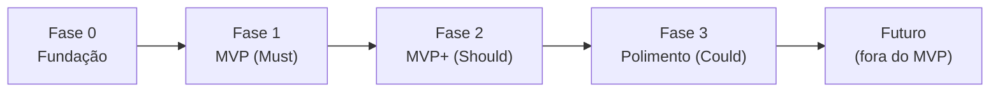

# 14 – Roadmap e backlog

Priorização por **MoSCoW** e por dependência técnica. O prazo da disciplina não foi informado, por isso o roadmap é organizado por **fases**, não por datas (PEN). Esforço: **P** (≤ 1 dia), **M** (2 a 3 dias), **G** (≥ 4 dias), estimativa inicial.

## Roadmap

| Fase | Objetivo | Entrega observável |
|---|---|---|
| **0 – Fundação** | Monorepo, ambiente, CI, banco, tema | `docker compose up` + apps abrindo, CI verde |
| **1 – MVP (Must)** | Ciclo completo cidadão → operadora → cidadão | Demonstração: cadastra, denuncia, painel recebe em tempo real, operador atualiza, app reflete |
| **2 – MVP+ (Should)** | Completar experiência e conformidade | Push, fotos, perfil/exclusão de conta, painel comunitário, previsão, lote, prioridade |
| **3 – Polimento (Could)** | Refinos | Busca, mapa em tela cheia, alterar endereço, E2E |
| **Futuro** | Evolução | Itens da seção "Fora do MVP" |

## Backlog priorizado

### Fase 0 – Fundação

| ID | Item | Esforço | Requisitos |
|---|---|---|---|
| B-001 | Criar monorepo (npm workspaces), ESLint, Prettier, `.editorconfig`, commitlint | P | RNF-019, [ADR-0003](adr/0003-monorepo-com-tres-aplicacoes.md) |
| B-002 | `docker-compose.yml` com PostgreSQL; `.env.example` | P | RNF-022, RNF-023 |
| B-003 | API base (Express, config, erros, logger) + Prisma + migrations iniciais + seed (bairros e operadores) | M | RNF-021, RN-021 |
| B-004 | App Expo + Expo Router + tema/tokens + fontes + componentes base | M | [06](06-design-system.md) |
| B-005 | Painel Vite + React Router + tokens | P | [06](06-design-system.md) |
| B-006 | Workflow de CI (lint, tipos e testes) | P | RNF-019 |

### Fase 1 – MVP (Must)

| ID | Item | Esforço | Requisitos / regras |
|---|---|---|---|
| B-010 | Domínio: status do bairro, transições, limite, permissões, protocolo + **testes unitários** | M | RN-004 a RN-007, RN-023, RF-023, RF-011 |
| B-011 | Auth: cadastro, login, JWT, RBAC, middleware | M | RF-001, RF-003, RF-026, RN-001, RN-020, RN-022 |
| B-012 | Telas T-01 e T-02 (cadastro/login) com consentimento e termos | M | RF-001, RF-002, RF-003 |
| B-013 | API de denúncias: criar, minhas, detalhe, histórico (transação) | G | RF-007, RF-011, RF-013, RF-014, RF-036, RN-006, RN-011, RN-012 |
| B-014 | Socket.IO: autenticação, salas e eventos | M | RF-024, RF-027, [ADR-0002](adr/0002-socketio-para-tempo-real.md) |
| B-015 | App: tela Registrar Denúncia com GPS, tipo, bairro, validações e rascunho | G | RF-007, RF-008, RNF-008 |
| B-016 | App: sucesso (T-06), Minhas denúncias (T-09), Detalhe (T-07) com tempo real | G | RF-012, RF-013, RF-014, RF-024 |
| B-017 | API de bairros/ocorrências: status por bairro, lista pública anonimizada, bairro mais próximo | M | RF-016, RF-019, RF-020, RN-014, RN-025 |
| B-018 | App: Home (T-03) e Ocorrências (T-04) com mapa, chips e lista | G | RF-016, RF-019, RF-020, RF-023 |
| B-019 | API painel: listagem com filtros, detalhe, atualizar status | M | RF-028, RF-030, RF-031, RF-032 |
| B-020 | Painel: login (P-01), lista e filtros, mapa (P-02) | G | RF-026, RF-028, RF-029 |
| B-021 | Painel: alerta visual e sonoro em tempo real | M | RF-027, S-19 |
| B-022 | Painel: detalhe e atualização de status com justificativa (P-03) | M | RF-030, RF-031, RF-032 |
| B-023 | Estados vazio/erro/carregando/offline e cache persistido | M | RNF-006, RNF-007, RNF-009 |
| B-024 | Testes de integração da API (fluxos principais) | M | [13](13-estrategia-de-testes.md) |
| B-025 | README com roteiro de demonstração e instruções de execução | P | — |

### Fase 2 – MVP+ (Should)

| ID | Item | Esforço | Requisitos |
|---|---|---|---|
| B-030 | Push: registro de token, envio com `expo-server-sdk`, abrir detalhe pelo toque; *development build* | G | RF-025, RN-019 |
| B-031 | Anexar até 3 fotos (upload, rota autenticada, miniaturas) | M | RF-009, RN-013, RNF-015 |
| B-032 | Pessoas afetadas e necessidade especial (consentimento específico) | P | RF-010, RN-015 |
| B-033 | Prioridade no painel (destaque e ordenação) | P | RF-035 |
| B-034 | Previsão de reparo (painel, detalhe e card do bairro) | M | RF-033, RN-009 |
| B-035 | Agrupamento por bairro e resolução em lote | M | RF-034, RN-016 |
| B-036 | Cancelar denúncia recebida | P | RF-015, RN-005 |
| B-037 | Perfil: ver/editar dados; **excluir conta** (anonimização) | M | RF-004, RF-005, RF-006, RN-024 |
| B-038 | Painel comunitário (indicadores de 30 dias) | P | RF-018, RN-017 |
| B-039 | Acessibilidade: rótulos, contraste, alvos de toque, fontes a 200% | M | RNF-024, [12](12-acessibilidade.md) |

### Fase 3 – Polimento (Could)

| ID | Item | Esforço | Requisitos |
|---|---|---|---|
| B-040 | Alterar endereço de consulta na Home | P | RF-017 |
| B-041 | Busca por bairro ou folha | P | RF-021 |
| B-042 | Mapa em tela cheia | P | RF-022 |
| B-043 | E2E (Playwright e Maestro) | M | [13](13-estrategia-de-testes.md) |
| B-044 | Revisão de segurança (rate limit, headers, validação de upload) e cobertura | M | RNF-014 |

### Fora do MVP (backlog futuro)

| ID | Item | Observação |
|---|---|---|
| B-100 | "Esqueci a senha" (e-mail) | Pedido no escopo; depende de serviço de e-mail |
| B-101 | Login com Google | Pedido no escopo |
| B-102 | **Integração real com a Equatorial Pará via API**, substituindo o painel | [ADR-0001](adr/0001-integracao-simulada-com-operadora.md) |
| B-103 | Aviso por WhatsApp | Fora do escopo definido |
| B-104 | Confirmação de denúncias por vizinhos | Remove "confirmações" do texto atual |
| B-105 | Vídeo como anexo | Limite de tamanho e armazenamento |
| B-106 | Fila de envio offline com idempotência | [ADR-0005](adr/0005-estrategia-offline-simples.md) |
| B-107 | Modo escuro | Pedido no escopo |
| B-108 | Polígonos de bairros (PostGIS) | Substituir os centros |
| B-109 | Armazenamento de fotos em nuvem e escala do Socket.IO (Redis) | [07](07-arquitetura.md) |
| B-110 | Bloqueio de contas com reincidência de improcedentes; verificação de e-mail | [11](11-seguranca-e-lgpd.md) |
| B-111 | Refresh token | [ADR-0004](adr/0004-autenticacao-jwt-com-rbac.md) |
| B-112 | Exportação de dados (portabilidade) | [11](11-seguranca-e-lgpd.md) |

## Rastreabilidade RF → backlog

| RF | Backlog | RF | Backlog | RF | Backlog |
|---|---|---|---|---|---|
| RF-001 | B-011, B-012 | RF-013 | B-013, B-016 | RF-025 | B-030 |
| RF-002 | B-012 | RF-014 | B-013, B-016 | RF-026 | B-011, B-020 |
| RF-003 | B-011, B-012 | RF-015 | B-036 | RF-027 | B-014, B-021 |
| RF-004 | B-037 | RF-016 | B-017, B-018 | RF-028 | B-019, B-020 |
| RF-005 | B-037 | RF-017 | B-040 | RF-029 | B-020 |
| RF-006 | B-037 | RF-018 | B-038 | RF-030 | B-019, B-022 |
| RF-007 | B-013, B-015 | RF-019 | B-017, B-018 | RF-031 | B-019, B-022 |
| RF-008 | B-015 | RF-020 | B-017, B-018 | RF-032 | B-019, B-022 |
| RF-009 | B-031 | RF-021 | B-041 | RF-033 | B-034 |
| RF-010 | B-032 | RF-022 | B-042 | RF-034 | B-035 |
| RF-011 | B-010, B-013 | RF-023 | B-010, B-017, B-018 | RF-035 | B-033 |
| RF-012 | B-016 | RF-024 | B-014, B-016 | RF-036 | B-013, B-022 |

## Riscos do cronograma

| Risco | Mitigação |
|---|---|
| Push exige *development build* e credenciais (PEN-04) | Push é Should; o Must funciona só com WebSocket |
| Mapas no Android exigem chave do Google (PEN-04) | Usar Expo Go na demonstração; plano B com tiles OSM (`UrlTile`) |
| Três aplicações em um prazo curto | Fase 1 mínima; telas do painel simples; reuso dos tokens |
| Telas ausentes no Figma (PEN-06) | Descrições em [05](05-telas-e-fluxos.md#telas-a-criar-no-protótipo) como guia |
