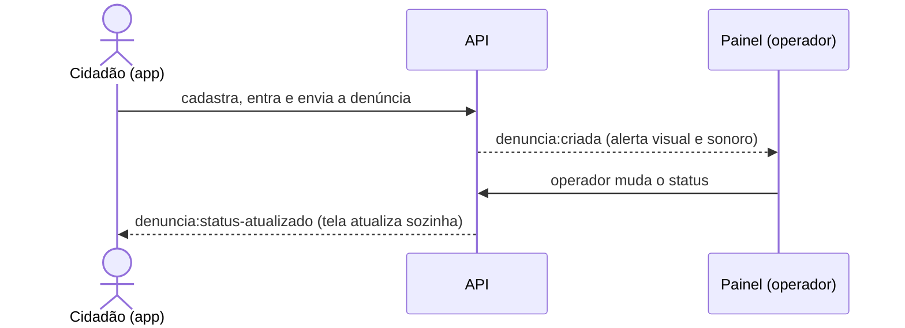
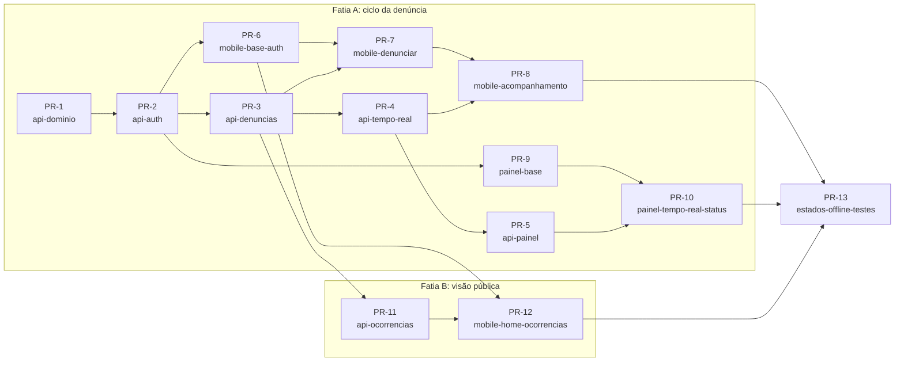

# 16 – Plano de implementação da Fase 1 (MVP Must)

> **Estado:** proposta para aprovação, **antes de qualquer código**. Nada deste plano foi implementado.
> **Base:** [14 – Roadmap e backlog](14-roadmap-e-backlog.md) (B-010 a B-025), contratos em [10 – API](10-api.md), dados em [09](09-modelo-de-dados.md), regras em [regras-de-negocio.md](02-requisitos/regras-de-negocio.md) e telas em [05](05-telas-e-fluxos.md).
> **Início:** 2026-11-19 (dia 2 do cronograma). A Fase 0 já está na `develop`.

## 1. Objetivo e critério de pronto

**Entrega da Fase 1:** o ciclo completo funciona ponta a ponta, só com os requisitos **Must**.

**A Fase 1 está pronta quando todos os itens abaixo passam:**

- [ ] Cidadão cria conta e entra no app (RF-001 a RF-003) e sai (RF-004).
- [ ] Cidadão registra uma denúncia com GPS (ou manualmente) e vê o protocolo (RF-007, RF-008, RF-011, RF-012).
- [ ] O painel recebe a denúncia **em até 2 s**, com alerta visual e sonoro, sem recarregar (RF-027).
- [ ] O operador filtra em lista e mapa, abre o detalhe e muda o status com justificativa quando for improcedente (RF-026, RF-028 a RF-032, RF-036).
- [ ] O app mostra a mudança **em até 2 s**, em "Minhas denúncias" e no detalhe, com histórico (RF-013, RF-014, RF-024).
- [ ] Home e Ocorrências mostram o status do bairro, o mapa e a lista pública anonimizada (RF-016, RF-019, RF-020, RF-023).
- [ ] `npm run lint`, `typecheck` e `test` passam; cobertura de `domain/` ≥ 90% (RNF-020); CI verde.

## 2. Escopo da fase (o que entra e o que fica de fora)

**Entram (Must):** RF-001, 002, 003, 004, 007, 008, 011, 012, 013, 014, 016, 019, 020, 023, 024, 026, 027, 028, 029, 030, 031, 032 e 036.

**Ficam para a Fase 2 (Should/Could), mesmo aparecendo nas telas:**

| Item | Onde aparece | Tratamento na Fase 1 |
|---|---|---|
| Fotos (RF-009), pessoas afetadas e necessidade especial (RF-010) | T-05 | O formulário **não** mostra esses campos; a API já aceita os campos opcionais (S-38) |
| Prioridade no painel (RF-035) | P-02 | A lista ordena por data; o campo `necessidadeEspecial` existe no banco |
| Cancelar denúncia (RF-015) | T-07, T-09 | Sem botão; a regra RN-005 já fica no domínio, com testes |
| Editar perfil e excluir conta (RF-005, RF-006) | T-08 | T-08 **mínimo**: dados, "Minhas denúncias" e "Sair" (S-37) |
| Painel comunitário (RF-018) | T-03 | Seção não exibida |
| Alterar endereço (RF-017), busca (RF-021), mapa em tela cheia (RF-022) | T-03, T-04 | Não exibidos |
| Previsão de reparo na UI (RF-033), agrupar/lote (RF-034) | P-03, P-02 | A API **aceita** `previsaoReparo` no `PATCH` de status (S-39); UI e lote ficam na Fase 2 |
| Push (RF-025) | — | Último item do projeto (D-03) |

## 3. Decisões técnicas propostas (a confirmar)

Seguem o padrão do projeto: na dúvida, a opção mais simples. Serão registradas em [01 – seção 8](01-visao-e-escopo.md#8-decisões-e-pendências) como **S-33 a S-41** (a confirmar) ao aprovar este plano.

| ID | Decisão | Motivo |
|---|---|---|
| S-33 | `POST /denuncias` aceita **JSON** na Fase 1; o `multipart` (fotos) entra com B-031 | Sem fotos na fase, JSON é mais simples. [10](10-api.md) será ajustado quando as fotos chegarem |
| S-34 | O protocolo (RN-023) vem de uma tabela `ProtocoloSequencia(ano, ultimo)` com incremento **atômico** (`INSERT … ON CONFLICT DO UPDATE … RETURNING`), numa nova migration | Sequência por ano, sem corrida entre requisições. Atualizar [09](09-modelo-de-dados.md) no PR-3 |
| S-35 | JWT com `jsonwebtoken`; validade por papel: **cidadão 7 dias, operador 8 horas** (S-08) | Simples e já decidido ([ADR-0004](adr/0004-autenticacao-jwt-com-rbac.md)) |
| S-36 | Testes de integração usam o banco **`taligado_test`** (separado do de desenvolvimento), com migrations aplicadas no `globalSetup` e tabelas limpas entre testes | Não apaga os dados de desenvolvimento; a CI já usa esse nome |
| S-37 | **T-08 mínimo** entra na Fase 1 (nome, e-mail, "Minhas denúncias", "Sair"). RF-004 passa a B-016 na rastreabilidade | "Sair" (RF-004) é Must e "Minhas denúncias" fica dentro do Perfil |
| S-38 | O formulário T-05 da Fase 1 **não tem** fotos, pessoas afetadas nem necessidade especial | São Should (B-031, B-032) |
| S-39 | O `PATCH /painel/denuncias/:id/status` já aceita `previsaoReparo` | Campo pequeno; evita mexer no contrato depois |
| S-40 | As regras de domínio recebem **dados simples** (sem Prisma) e o *service* faz a consulta | Mantém `domain/` puro e testável (RNF-020) |
| S-41 | Rotas do app reorganizadas em `(auth)` e `(app)/(tabs)`, protegidas com `Stack.Protected` (a API exata será conferida na documentação do **SDK 58**) | O template do SDK 58 mudou muita coisa; confirmar antes de usar |

## 4. Mapa de PRs e dependências

Cada PR sai de uma branch a partir da `develop` e **volta para a `develop`** (você aprova o merge). PRs pequenos, um assunto cada.

Ordem pensada em **duas fatias**: primeiro a **fatia vertical** (cidadão envia → painel recebe → operador atualiza → app mostra), que é o coração da demonstração; depois a **visão pública** (Home e Ocorrências).

| PR | Branch | Backlog | Requisitos | Esforço |
|---|---|---|---|---|
| PR-1 | `feature/api-dominio` | B-010 | RN-004 a 007, 009, 014, 015, 023, 025 | M |
| PR-2 | `feature/api-auth` | B-011 | RF-001 a 003, 026 · RN-001, 020, 022 | M |
| PR-3 | `feature/api-denuncias` | B-013 (+ `GET /bairros` e `/proximo` de B-017) | RF-007, 011, 013, 014, 036 · RN-006, 011, 012, 023, 025 | G |
| PR-4 | `feature/api-tempo-real` | B-014 | RF-024, 027 · ADR-0002 | M |
| PR-5 | `feature/api-painel` | B-019 | RF-028, 030, 031, 032 | M |
| PR-6 | `feature/mobile-base-auth` | B-012 | RF-001 a 003 | M |
| PR-7 | `feature/mobile-denunciar` | B-015 | RF-007, 008, 012 · RNF-008 | G |
| PR-8 | `feature/mobile-acompanhamento` | B-016 | RF-004, 013, 014, 024 | G |
| PR-9 | `feature/painel-base` | B-020 | RF-026, 028, 029 | G |
| PR-10 | `feature/painel-tempo-real-status` | B-021, B-022 | RF-027, 030 a 032 | M |
| PR-11 | `feature/api-ocorrencias` | B-017 (restante) | RF-016, 019, 020, 023 · RN-007, 009, 014 | M |
| PR-12 | `feature/mobile-home-ocorrencias` | B-018 | RF-016, 019, 020, 023 | G |
| PR-13 | `feature/estados-offline-testes` | B-023, B-024, B-025 | RNF-006, 007, 009 | M |

**Paralelismo (se os três integrantes trabalharem juntos):** após o **PR-2** (contrato de autenticação), a trilha da **API** (PR-3 a 5), a do **app** (PR-6 a 8) e a do **painel** (PR-9 e 10) podem andar em paralelo, usando os contratos de [10](10-api.md). Para um desenvolvedor só (ou para mim), a ordem numérica acima já respeita as dependências.

---

## 5. Plano detalhado por PR

Convenções: arquivos em `apps/api/src/...` salvo indicação; testes em `apps/api/tests/...`. Mensagens de commit seguem o Conventional Commits.

### PR-1 · `feature/api-dominio` (B-010)

**Objetivo:** todas as regras de negócio como **funções puras**, com testes, antes de qualquer rota.

| Arquivo (`src/domain/`) | Funções | Regras |
|---|---|---|
| `tipos.ts` | Tipos `Papel`, `TipoDenuncia`, `StatusDenuncia`, `StatusBairro` (união de strings, espelhando o Prisma) e `STATUS_EM_ABERTO` | RN-002, RN-003 |
| `status-bairro.ts` | `calcularStatusBairro(emAberto)` → `'SEM_LUZ' \| 'OSCILACAO' \| 'NORMAL'` | RN-007 |
| `previsao.ts` | `validarPrevisao(data, agora)`; `menorPrevisaoFutura(previsoes, agora)` | RN-009 |
| `transicoes.ts` | `validarTransicao({ de, para, papel, ehAutor, justificativa, lote })` → `ok` ou código de erro; `acoesDisponiveis(status, papel)` | RN-004, RN-005, RN-010, RN-016 |
| `limite-denuncia.ts` | `podeCriarDenuncia(statusDasDenunciasDoAutor)` | RN-006 |
| `permissoes.ts` | `podeVerDenuncia(usuario, denuncia)`, `exigirPapel`, `projetarOcorrenciaPublica(denuncia)` (sem autor, fotos, protocolo; coordenadas com 3 casas) | RN-001, RN-014 |
| `protocolo.ts` | `formatarProtocolo(ano, sequencia)` → `TL-AAAA-NNNNNN`; `protocoloValido(texto)` | RN-023 |
| `prioridade.ts` | `compararPrioridade(a, b)` (prioritárias antes; dentro do grupo, mais antigas primeiro) | RN-015 |
| `bairro-proximo.ts` | `distanciaKm(a, b)` (Haversine); `bairroMaisProximo(ponto, bairros, maxKm = 15)` | RN-025 |
| `indicadores.ts` | `taxaResolucao(resolvidas, registradas)` (limitada a 100%) | RN-017 |

**Testes (Vitest, sem banco), um arquivo por módulo.** Casos obrigatórios:
- `status-bairro`: lista vazia ⇒ `NORMAL`; só oscilação ⇒ `OSCILACAO`; qualquer sem energia ⇒ `SEM_LUZ` (precedência); ignora status finais.
- `transicoes`: **todas** as 5 transições válidas da tabela de RN-004; todas as inválidas (matriz completa de 5×5 estados); `IMPROCEDENTE` sem justificativa e com justificativa de menos de 10 caracteres; cancelar só pelo autor e só em `RECEBIDA`; cidadão não faz transição de operador; exceção do lote (`RECEBIDA → RESOLVIDA` só com `lote: true`); estados finais não mudam.
- `limite-denuncia`: 0 em aberto libera; `RECEBIDA` e `EM_ATENDIMENTO` bloqueiam; finais liberam.
- `permissoes`: visibilidade de cada campo por papel (tabela de RN-014).
- `protocolo`, `prioridade`, `bairro-proximo` (inclui fora de 15 km), `previsao`, `indicadores`.

**Aceite:** cobertura de `src/domain` ≥ 90% (`npm run test:coverage -w apps/api`); nenhum import de Prisma, Express ou Socket.IO em `domain/`.
**Config:** adicionar limiar de cobertura (`coverage.thresholds`) para `src/domain/**` no `vitest.config.ts`, para a CI falhar abaixo de 90%.
**Commits:** `feat(api): adiciona regras de domínio de status, transições e permissões` · `test(api): cobre regras de domínio` (ou um só).

### PR-2 · `feature/api-auth` (B-011)

**Dependências novas:** `jsonwebtoken`, `@types/jsonwebtoken`, `express-rate-limit`.

| Arquivo | Conteúdo |
|---|---|
| `modules/auth/schemas.ts` | Zod: `registerSchema` (nome 2–100, e-mail único em minúsculas, senha ≥ 8, `telefone` opcional no padrão BR, `aceiteTermos` obrigatório `true`, `versaoTermos`), `loginSchema` |
| `modules/auth/service.ts` | `registrar()` (bcrypt custo 10, grava `consentimentoEm` e `versaoTermos`, papel `CIDADAO`), `entrar()` (mensagem genérica em falha), `gerarToken()` (HS256, `sub` e `papel`; 7 d cidadão, 8 h operador) |
| `modules/auth/routes.ts` | `POST /api/v1/auth/register`, `POST /api/v1/auth/login`, `GET /api/v1/me` |
| `shared/auth.ts` | Middlewares `autenticar` (lê o `Bearer`, carrega o usuário do banco) e `exigirPapel(...papeis)` |
| `shared/validacao.ts` | Middleware que aplica um schema Zod e devolve `400 VALIDACAO_ERRO` com `detalhes` por campo |
| `shared/rate-limit.ts` | Limite geral (100 req/min) e de login (5/min por IP e e-mail), conforme S-18 |
| `app.ts` | Registrar rotas sob `/api/v1`, `createApp` recebe `prisma` por injeção |

**Regras:** RN-001 (operador não se cadastra), RN-020, RN-022, RNF-011 a 014.
**Testes de integração** (`tests/integration/auth.test.ts`, banco de teste): cadastro 201 sem `senhaHash` na resposta; e-mail repetido 409 `EMAIL_JA_CADASTRADO`; senha curta 400; sem aceite 400; login ok/erro 401 genérico; `GET /me` com e sem token; token de operador de 8 h; 429 no limite de login.
**Infra de teste (primeira vez que há integração):** script/`globalSetup` que aplica as migrations em `taligado_test` e limpa as tabelas entre testes; documentação de como criar o banco (`docker exec taligado-db createdb -U taligado taligado_test`).
**Aceite:** requisitos RF-001 a 003 e RF-026 (lado da API) atendidos; sem dado pessoal em logs.
**Commits:** `feat(api): adiciona cadastro, login com jwt e controle de acesso por papel` · `test(api): adiciona infraestrutura de testes de integração com banco`.

### PR-3 · `feature/api-denuncias` (B-013)

**Migration nova** `protocolo_sequencia`: tabela `ProtocoloSequencia(ano int PK, ultimo int)` (S-34). Atualizar [09](09-modelo-de-dados.md).

| Arquivo | Conteúdo |
|---|---|
| `modules/denuncias/schemas.ts` | `criarDenunciaSchema`: `tipo`, `bairroId`, `logradouro` obrigatórios; `cep`, `pontoReferencia`, `descricao` (≤ 500), `latitude`/`longitude`, `faixaPessoas`, `necessidadeEspecial`, `detalheNecessidade` (obrigatório se `necessidadeEspecial`) opcionais |
| `modules/denuncias/service.ts` | `criar()`: dentro de **uma transação** — checa `podeCriarDenuncia`, gera o protocolo atômico, cria a denúncia `RECEBIDA` e o 1º `HistoricoStatus`; **captura o erro de violação do índice parcial** (`P2002`) como `409 DENUNCIA_EM_ABERTO` (cobre a corrida entre duas requisições); `minhas()`, `detalhe()` (histórico com `por: "Você" \| "Equatorial Pará"`) |
| `modules/denuncias/routes.ts` | `POST /denuncias`, `GET /denuncias/minhas`, `GET /denuncias/:id` (só do autor; 404 para outro usuário, sem revelar existência) |
| `modules/bairros/routes.ts` | `GET /bairros` (lista fixa) e `GET /bairros/proximo?lat&lng` (centro mais próximo até 15 km, RN-025; 404 fora do raio). Entram aqui porque o formulário do PR-7 precisa deles |
| `realtime/publicador.ts` | Interface `Publicador` (`denunciaCriada`, `statusAtualizado`, …) com implementação **vazia** por enquanto; o service a recebe por injeção e chama **depois do commit**. O PR-4 troca pela implementação real |
| `shared/protocolo-sequencia.ts` | Incremento atômico em SQL (`INSERT … ON CONFLICT … DO UPDATE SET ultimo = ultimo + 1 RETURNING ultimo`) |

**Regras:** RN-006, RN-011, RN-012 (bairro obrigatório; coordenadas opcionais), RN-023.
**Testes de integração:** `GET /bairros` e `GET /bairros/proximo` (inclusive fora do raio); 201 com protocolo `TL-AAAA-NNNNNN` e histórico inicial; protocolos sequenciais e únicos; 409 com outra em aberto; **duas criações simultâneas do mesmo autor ⇒ só uma passa**; 400 por campo obrigatório ausente, tipo inválido, bairro inexistente; `minhas` só traz as próprias e ordena da mais recente; `detalhe` de outro usuário 404; histórico completo; criar sem coordenadas (GPS negado) funciona.
**Aceite:** RF-007, 011, 013, 014, 036 (lado da API).
**Commits:** `feat(db): adiciona tabela de sequência de protocolo` · `feat(api): adiciona registro, listagem e detalhe de denúncias`.

### PR-4 · `feature/api-tempo-real` (B-014)

| Arquivo | Conteúdo |
|---|---|
| `realtime/socket.ts` | Middleware de **handshake** (`auth.token` → valida JWT, recusa se inválido); ao conectar, entra nas salas `papel:OPERADOR` **ou** `cidadaos`, e `usuario:{id}` (o cliente não escolhe) |
| `realtime/publicador.ts` | Implementação real: `denuncia:criada` (operadores), `ocorrencia:atualizada` e `bairro:status-atualizado` (cidadãos, anonimizados), `denuncia:status-atualizado` (autor e operadores) — payloads exatamente como em [10](10-api.md#eventos-websocket) |
| `server.ts` / `app.ts` | Injeta o `io` e o publicador nos serviços |

**Testes** (Vitest + `socket.io-client` em memória, banco de teste): conexão sem token ou com token inválido é recusada; operador recebe `denuncia:criada` ao criar; o autor recebe `denuncia:status-atualizado`; **outro cidadão não** recebe eventos privados; o evento público não contém campo pessoal; o evento sai **depois** do commit (a denúncia já existe quando o cliente consulta).
**Aceite:** RF-024 e RF-027 (lado da API); latência medida localmente ≤ 2 s (RNF-002).
**Commit:** `feat(api): adiciona socket.io com autenticação, salas e eventos de denúncia`.

### PR-5 · `feature/api-painel` (B-019)

| Rota (`/api/v1/painel`, só `OPERADOR`) | Comportamento |
|---|---|
| `GET /denuncias` | Filtros `status`, `tipo`, `bairroId`, `page`, `limite`; ordenação por prioridade (RN-015) e depois por data |
| `GET /denuncias/:id` | Detalhe completo: autor (nome, telefone), local, descrição, histórico |
| `PATCH /denuncias/:id/status` | Corpo `{ status, justificativa?, previsaoReparo? }`; usa `validarTransicao`; transação (status + histórico); responde 422 `TRANSICAO_INVALIDA`, `JUSTIFICATIVA_OBRIGATORIA` ou `PREVISAO_NO_PASSADO`; emite eventos (via publicador) |

**Testes de integração:** cidadão recebe 403; filtros combinados; ordem por prioridade; transições válidas e inválidas; improcedente sem justificativa 422; **atomicidade** (falha ao gravar o histórico desfaz o status); previsão no passado 422; eventos emitidos.
**Aceite:** RF-028, 030, 031, 032 e RF-036 (lado da API).
**Commit:** `feat(api): adiciona listagem, detalhe e atualização de status para o painel`.

### PR-6 · `feature/mobile-base-auth` (B-012)

**Dependências (via `npx expo install`):** `@tanstack/react-query`, `zustand`, `react-hook-form`, `zod`, `@hookform/resolvers`, `expo-secure-store`, `socket.io-client`. Antes de usar `Stack.Protected` e a `Tabs` do SDK 58, **conferir a documentação do SDK 58** (S-41).

| Arquivo (`apps/mobile/src/`) | Conteúdo |
|---|---|
| `app/_layout.tsx` | Providers (QueryClient, sessão) e `Stack.Protected` por sessão: `(auth)` sem token, `(app)` com token |
| `app/(auth)/login.tsx`, `cadastro.tsx` | T-02 e T-01 com a barra `TopAuthBar` (Entrar/Cadastrar) |
| `app/(app)/(tabs)/...` | Move as abas atuais para dentro de `(app)` |
| `services/http.ts` | Cliente HTTP: base `API_URL`, `Authorization`, *timeout* de 15 s, erro normalizado para `{ codigo, mensagem, detalhes }`, mensagens em pt-BR (RNF-005) |
| `store/session.ts` | Zustand: usuário e token; token em `expo-secure-store`; `hidratar()` ao abrir o app |
| `features/auth/{api,schemas,hooks}.ts` | `registrar`, `entrar`, `sair`; schemas Zod espelhando RN-022 |
| `components/` | `Button` (usa `colors.action`, mínimo 48 dp), `TextField` (rótulo, erro, mostrar senha), `Checkbox`, `TopAuthBar`, `EmptyState`, `ErrorState`, `LoadingState` |
| `app/termos.tsx`, `privacidade.tsx` | Mostram os textos de `docs/legal/` (cópia em `src/legal/`) |

**Telas:** T-01 (nome, e-mail, telefone opcional, senha e confirmação, aceite dos Termos, rodapé "© 2026 Equipe Tá Ligado?"; **sem** CPF, nascimento e Google) e T-02 (e-mail e senha), seguindo [05](05-telas-e-fluxos.md).
**Testes (Jest):** schemas de cadastro e login; cliente HTTP (mapeia 401/409/rede/*timeout* para mensagens); *store* de sessão (grava e limpa o token); botão desabilitado sem aceite.
**Aceite:** RF-001 a 003 ponta a ponta com a API local; abrir o app com sessão válida vai direto às abas; alvos ≥ 48 dp; contraste dos botões em `#006E2C`.
**Commits:** `feat(mobile): adiciona infraestrutura de http, sessão e componentes base` · `feat(mobile): adiciona telas de cadastro e login`.

### PR-7 · `feature/mobile-denunciar` (B-015)

**Dependências:** `expo-location`, `react-native-maps` (versão do SDK), `@react-native-async-storage/async-storage`.

| Arquivo | Conteúdo |
|---|---|
| `app/(app)/denunciar.tsx` | T-05 (modal): introdução, mini-mapa com pino e selo "GPS Ativo" / "GPS desativado", aviso de responsabilidade recolhível, formulário |
| `features/denuncia/schemas.ts` | Zod: `tipo`, `bairroId`, `logradouro` obrigatórios; descrição ≤ 500 |
| `features/denuncia/hooks.ts` | `useCriarDenuncia` (mutation); trata 409 com "Ver minha denúncia em aberto" |
| `features/denuncia/localizacao.ts` | Pede permissão, obtém o GPS, geocodificação reversa para o logradouro, `GET /bairros/proximo` para o bairro; falha de GPS cai no modo manual |
| `features/denuncia/rascunho.ts` | Salva o formulário no AsyncStorage a cada alteração; limpa só após `201` (RNF-008) |
| `app/(app)/denuncia/sucesso.tsx` | T-06: protocolo (copiar), mensagem "Sua denúncia foi enviada à Equatorial Pará", botões "Acompanhar denúncia" e "Voltar ao início" |

**Campos da Fase 1 (S-38):** tipo (Sem energia/Oscilação), logradouro, bairro (lista da API), CEP e ponto de referência opcionais, descrição opcional. **Sem** fotos, pessoas e necessidade especial.
**Dependência de API:** `GET /bairros` e `GET /bairros/proximo`, entregues no **PR-3**.
**Testes (Jest):** schema; regra de rascunho (salva, restaura, limpa); mapeamento de erro 409; formatação do protocolo.
**Aceite:** RF-007, 008, 012 e RNF-008; com GPS negado o envio funciona escolhendo o bairro; sem internet os dados continuam no formulário; mensagem do 409 leva à denúncia aberta.
**Commits:** `feat(mobile): adiciona formulário de denúncia com localização por gps e rascunho` · `feat(mobile): adiciona tela de denúncia enviada com protocolo`.

### PR-8 · `feature/mobile-acompanhamento` (B-016)

| Arquivo | Conteúdo |
|---|---|
| `services/socket.ts` + `providers/SocketProvider.tsx` | Conecta com o token; ao receber `denuncia:status-atualizado`, atualiza o cache do TanStack Query (`setQueryData`/`invalidateQueries`); ao **reconectar**, refaz as consultas ativas (RNF-009) |
| `app/(app)/minhas-denuncias.tsx` | T-09: lista (protocolo, tipo, bairro, selo de status), vazio "Você ainda não fez denúncias" |
| `app/(app)/denuncia/[id].tsx` | T-07: selo de status, endereço, descrição, previsão (se houver), justificativa (se improcedente), **histórico** em linha do tempo (`StatusTimeline`) |
| `app/(app)/(tabs)/perfil.tsx` | T-08 **mínimo**: nome, e-mail, telefone, "Minhas denúncias" e "Sair" (limpa token e desconecta o socket) |
| `components/{StatusBadge,StatusTimeline,ComplaintListItem}.tsx` | Cores de status por [06](06-design-system.md) (S-26) |

**Testes (Jest):** *reducers*/funções que aplicam um evento ao cache; mapeamento de status para rótulo e cor; ordenação da lista; "Sair" limpa a sessão.
**Aceite:** RF-004, 013, 014, 024; com a tela de detalhe aberta, a mudança feita no painel aparece em ≤ 2 s sem recarregar (teste manual com os dois lados).
**Commits:** `feat(mobile): adiciona socket com atualização do cache em tempo real` · `feat(mobile): adiciona minhas denúncias, detalhe com histórico e perfil mínimo`.

### PR-9 · `feature/painel-base` (B-020)

**Dependências:** `leaflet`, `react-leaflet`, `@types/leaflet`, `@tanstack/react-query`, `socket.io-client`, `zustand` (ou contexto simples).

| Arquivo (`apps/painel/src/`) | Conteúdo |
|---|---|
| `services/http.ts`, `store/sessao.ts` | Cliente HTTP e sessão; token em `sessionStorage` (decisão do [ADR-0004](adr/0004-autenticacao-jwt-com-rbac.md)); recusa papel `CIDADAO` |
| `pages/LoginPage.tsx` | **P-01** |
| `routes.tsx` | Rotas protegidas (`/`, `/denuncias/:id`), redireciona ao login sem sessão ou com token expirado |
| `pages/PainelPage.tsx` | **P-02** (parte 1): barra superior (usuário, conexão, sair), filtros (status, tipo, bairro), abas **Lista** e **Mapa** |
| `components/{TabelaDenuncias,Filtros,MapaDenuncias}.tsx` | Tabela com protocolo, tipo, bairro/rua, status e tempo desde o envio; mapa Leaflet + OpenStreetMap com pinos coloridos por status/tipo; denúncias sem coordenadas ficam só na lista |

**Testes (Vitest + Testing Library):** login (sucesso, erro, papel errado); filtros montam a consulta certa; tabela renderiza estados vazio/erro/carregando; rota protegida.
**Aceite:** RF-026, 028, 029; navegação por teclado e foco visível ([12](12-acessibilidade.md)).
**Commits:** `feat(painel): adiciona login do operador e rotas protegidas` · `feat(painel): adiciona lista, filtros e mapa de denúncias`.

### PR-10 · `feature/painel-tempo-real-status` (B-021, B-022)

| Arquivo | Conteúdo |
|---|---|
| `services/socket.ts` | Conexão autenticada; `denuncia:criada` insere no topo da lista (cache do TanStack Query) |
| `components/{AlertaNovaDenuncia,BotaoSom}.tsx`, `services/som.ts` | **Alerta visual** (toast/banner + destaque temporário da linha) e **sonoro** (`AudioContext`, sem arquivo de áudio), só após o clique em "Ativar som" (S-19); região `aria-live` para leitores de tela |
| `components/IndicadorConexao.tsx` | "Conectado" / "Reconectando…"; ao reconectar, refaz a consulta |
| `pages/DetalhePage.tsx` | **P-03**: blocos Autor, Local, Ocorrência, Histórico; ações **conforme o status** (`acoesDisponiveis`): "Iniciar atendimento", "Resolver", "Improcedente" (abre campo de justificativa obrigatório) |

**Testes:** ações exibidas por status; justificativa obrigatória no formulário; um evento `denuncia:criada` simulado insere a linha e dispara o alerta; reconexão refaz a consulta.
**Aceite:** RF-027, 030, 031, 032, 036 (histórico visível); **teste ponta a ponta manual dos três lados** conforme o roteiro da seção 8.
**Commits:** `feat(painel): adiciona alerta visual e sonoro de novas denúncias em tempo real` · `feat(painel): adiciona detalhe da denúncia e atualização de status`.

> **Marco 1 (fim da fatia A):** com o PR-10 concluído, a demonstração ponta a ponta já funciona.

### PR-11 · `feature/api-ocorrencias` (B-017)

| Rota | Comportamento |
|---|---|
| `GET /bairros/status` | Status calculado por bairro, contagem em aberto e menor previsão futura (RN-007, RN-009) |
| `GET /ocorrencias?status&bairroId&q&page` | Lista **pública anonimizada** + `totais` dos chips; "Restabelecidos" = resolvidas nas últimas 24 h (S-21); coordenadas arredondadas (RN-014) |

**Testes de integração:** a resposta **nunca** contém `autor`, `telefone`, `protocolo`, fotos, pessoas ou necessidade especial; soma dos chips = "Todos"; status do bairro nas combinações de RN-007; previsão só futura; `proximo` fora do raio.
**Aceite:** lado da API de RF-016, 019, 020, 023. (Indicadores, RF-018, ficam na Fase 2; `GET /bairros` e `/proximo` já vieram no PR-3.)
**Commit:** `feat(api): adiciona bairros, status por bairro e ocorrências públicas anonimizadas`.

### PR-12 · `feature/mobile-home-ocorrencias` (B-018)

| Arquivo | Conteúdo |
|---|---|
| `app/(app)/(tabs)/index.tsx` | **T-03**: "Olá, {nome}!", selo Rede Estável/Instável do bairro atual (RN-008, RN-025), banner "Faltou energia? Denuncie agora" (CTA para T-05), mini-mapa, "Como funciona" (3 passos) e contatos (placeholders de `constants.ts`). Sem painel comunitário, sem "alterar endereço" |
| `app/(app)/(tabs)/ocorrencias.tsx` | **T-04**: card "Localização atual" (status, "N denúncias em aberto no seu bairro", previsão), chips com contagem (Todos, Sem luz, Oscilação, Restabelecidos), mapa (círculo por bairro na cor do status + pinos), lista dos lugares, banner "Denunciar" |
| `components/{MapaOcorrencias,BairroCircle,FilterChip,OccurrenceListItem,LocationStatusCard}.tsx` | Conforme o design system |
| `services/socket.ts` | Eventos `ocorrencia:atualizada` e `bairro:status-atualizado` atualizam Home e Ocorrências |

**Testes (Jest):** mapeamento status ⇒ cor/rótulo; contagem dos chips; texto do selo; evento atualiza o cache. Verificação visual no Expo Go.
**Aceite:** RF-016, 019, 020, 023; alterar o status no painel muda o selo e a cor do círculo em ≤ 2 s; nenhum dado pessoal na lista.
**Commits:** `feat(mobile): adiciona tela inicial com status do bairro` · `feat(mobile): adiciona ocorrências com mapa, chips e lista pública`.

### PR-13 · `feature/estados-offline-testes` (B-023, B-024, B-025)

| Item | Conteúdo |
|---|---|
| Estados (B-023) | `LoadingState`/`EmptyState`/`ErrorState` com "Tentar novamente" em **todas** as telas que buscam dados (RNF-006) |
| Offline (B-023) | Cache do TanStack Query persistido em AsyncStorage (`@tanstack/react-query-persist-client` + persister), `NetInfo` e `OfflineBanner` com a data da última atualização; formulário preserva o rascunho sem rede ([ADR-0005](adr/0005-estrategia-offline-simples.md)) |
| Testes (B-024) | Fecha as lacunas de integração da API (fluxos de [13](13-estrategia-de-testes.md)); cobertura de `domain` ≥ 90% e da API ≥ 70% |
| README (B-025) | **Roteiro de demonstração** (seção 8) e instruções do banco de teste |
| Dados de demonstração | Script opcional `npm run db:seed:demo -w apps/api` com algumas denúncias de exemplo (nunca em produção) |

**Commits:** `feat(mobile): adiciona estados de tela e cache offline` · `test(api): completa testes de integração dos fluxos principais` · `docs: adiciona roteiro de demonstração`.

---

## 6. Cronograma da Fase 1

Segue o cronograma de [14](14-roadmap-e-backlog.md#cronograma-de-uma-semana). Por ser apertado, a fatia A é prioridade absoluta.

| Dia | Data | PRs | Marco |
|---|---|---|---|
| 2 | 19/11 (qui) | PR-1, PR-2, PR-3 | API com domínio testado, autenticação e denúncias |
| 3 | 20/11 (sex) | PR-4, PR-5, PR-6, PR-7 | API em tempo real; app já cadastra, entra e envia denúncia |
| 4 | 21/11 (sáb) | PR-8, PR-9, PR-10 | **Marco 1:** ciclo ponta a ponta funcionando |
| 5 | 22/11 (dom) | PR-11, PR-12, PR-13 | **Marco 2:** Fase 1 completa; entram os *Should* que sobrarem |

> **Realidade do prazo:** são 13 PRs em 4 dias. Com os três integrantes em paralelo (API, app e painel) é viável. Com uma pessoa só, a **regra de corte** é: primeiro entregar o **Marco 1** (fatia A); depois a fatia B (PR-11 e PR-12); o PR-13 pode ser reduzido a estados de tela + roteiro de demonstração. Os itens *Should* da Fase 2 seguem a ordem de corte já definida em [14](14-roadmap-e-backlog.md#cronograma-de-uma-semana).

## 7. Estratégia de testes da Fase 1

| Camada | O que | Ferramenta | Quando |
|---|---|---|---|
| Domínio | Regras puras, matriz completa de transições | Vitest | PR-1 (antes de qualquer rota) |
| API (integração) | Fluxos com banco `taligado_test`: auth, denúncias, painel, ocorrências, atomicidade, concorrência | Vitest + Supertest | PR-2 em diante |
| Tempo real | Handshake, salas, privacidade dos eventos, emissão pós-commit | Vitest + `socket.io-client` | PR-4 |
| App | Schemas, cliente HTTP, sessão, rascunho, aplicação de eventos ao cache | Jest + `jest-expo` | PR-6 a 8, 12 |
| Painel | Login, filtros, ações por status, alerta | Vitest + Testing Library | PR-9, 10 |
| Manual | Roteiro ponta a ponta com app, painel e API | Expo Go + navegador | PR-10 e ao final |

**Banco de teste (S-36):** criar uma vez com `docker exec taligado-db createdb -U taligado taligado_test`. O `globalSetup` aplica as migrations (`prisma migrate deploy`) e cada teste limpa as tabelas. A CI já cria `taligado_test` (serviço PostgreSQL) e roda os testes nele.
**Cobertura (RNF-020):** `domain/` ≥ 90% (com limiar que falha a CI), API ≥ 70%, app e painel ≥ 60% na lógica.

## 8. Roteiro de demonstração (verificação final)

1. `npm run db:up`, `npm run db:seed`, `npm run dev`.
2. No painel: entrar como `operador@taligado.local`.
3. No celular (Expo Go, mesma conta Expo): **cadastrar** uma conta de cidadão e entrar.
4. Em T-05, escolher "Sem energia", conferir o bairro pelo GPS e **enviar**. Ver o protocolo.
5. **No painel, sem recarregar:** a denúncia aparece no topo com alerta e som (≤ 2 s).
6. No painel: filtrar por status, ver no mapa, abrir o detalhe e **iniciar atendimento**.
7. **No app:** o detalhe e "Minhas denúncias" mostram "Em atendimento" em ≤ 2 s, com o histórico.
8. No painel: marcar como **Resolvida**; o app atualiza e libera uma nova denúncia.
9. Home e Ocorrências: o selo e o círculo do bairro voltam a "Normal".
10. Tentar uma 2ª denúncia com a 1ª em aberto: mensagem de limite (409).
11. Desligar a internet do celular: telas em cache com aviso "Sem conexão".

## 9. Definição de pronto

**Por PR:**
- [ ] Branch a partir da `develop`, com nome do plano; PR para a `develop`.
- [ ] Testes novos para as regras e os fluxos do PR; `lint`, `typecheck`, `test` e `format:check` passam; CI verde.
- [ ] Contratos de [10](10-api.md) respeitados; se mudarem, o documento é atualizado **no mesmo PR**.
- [ ] Sem segredo, `.env` ou dado pessoal em código e logs; visibilidade por papel conforme RN-014.
- [ ] Tokens do design system, alvos ≥ 48 dp e contraste AA nas telas novas.
- [ ] `CHANGELOG.md` atualizado quando visível ao usuário.

**Da fase:** todos os itens da seção 1 e o roteiro da seção 8 executado sem erro.

## 10. Riscos e mitigações

| Risco | Impacto | Mitigação |
|---|---|---|
| Prazo de 4 dias para 13 PRs | Alto | Fatia vertical primeiro (Marco 1); trabalho em paralelo; regra de corte da seção 6 |
| SDK 58 do Expo é novo (rotas protegidas, mapas, localização) | Médio | Conferir a documentação do SDK 58 antes de cada módulo; validar cada tela no Expo Go ao fim do PR |
| Wi-Fi da universidade isola aparelhos | Médio | `--tunnel` ou *hotspot* (README); a API precisa ser alcançável pelo celular (`EXPO_PUBLIC_API_URL`) |
| Mapas e geocodificação no Expo Go | Médio | Plano B: preencher o endereço manualmente e usar `UrlTile` (OSM) se o mapa do Google falhar |
| Corrida na criação de denúncia (RN-006) | Médio | Índice único parcial no banco **e** tratamento de `P2002`; teste de concorrência |
| Eventos em tempo real perdidos na desconexão | Médio | Refetch ao reconectar (RNF-009); fonte de verdade é a API REST |
| Alerta sonoro bloqueado pelo navegador | Baixo | Botão "Ativar som" (S-19) e alerta visual sempre presente |
| Testes de integração lentos ou frágeis | Baixo | Banco separado, limpeza por `TRUNCATE`, poucos testes pesados |

## 11. O que preciso que você confirme

1. **O plano e a ordem de PRs** (fatia A primeiro, depois a B) estão bons?
2. As decisões **S-33 a S-41** (seção 3).
3. As decisões **S-22 a S-32**, que seguem pendentes desde a Fase 0. Nenhuma bloqueia o PR-1, mas **S-22** (e-mail somente leitura) e **S-29** (sem controle de versão no `PATCH` de status) afetam a API logo adiante. Sem resposta, sigo com o que está documentado.
4. **Quem trabalha em quê**, se os três forem desenvolver em paralelo (por exemplo: API, app e painel), para eu organizar as branches sem conflito.
